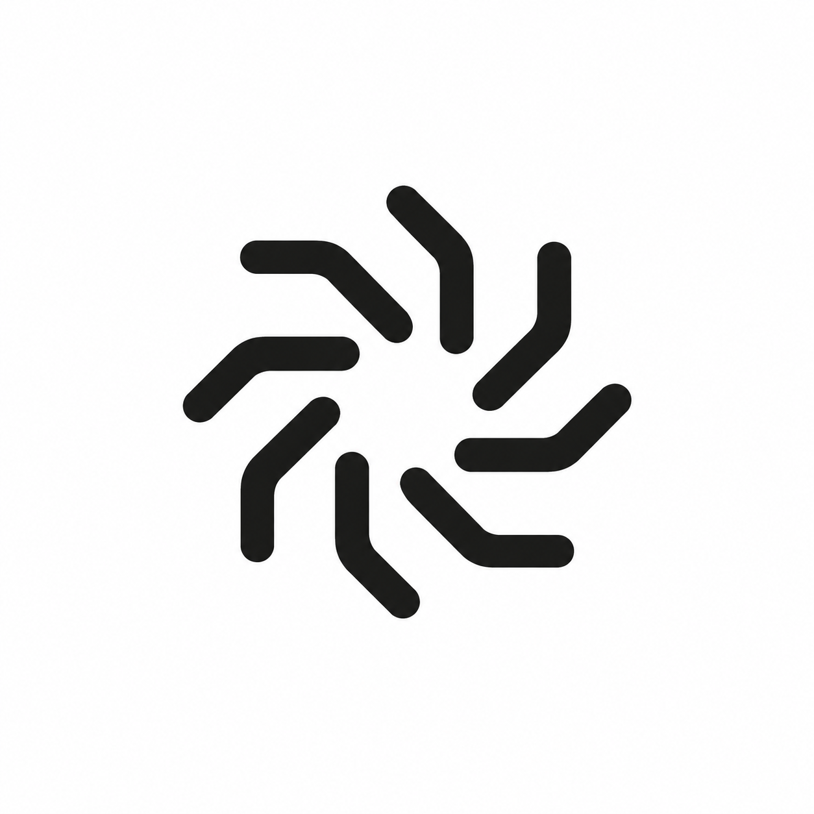
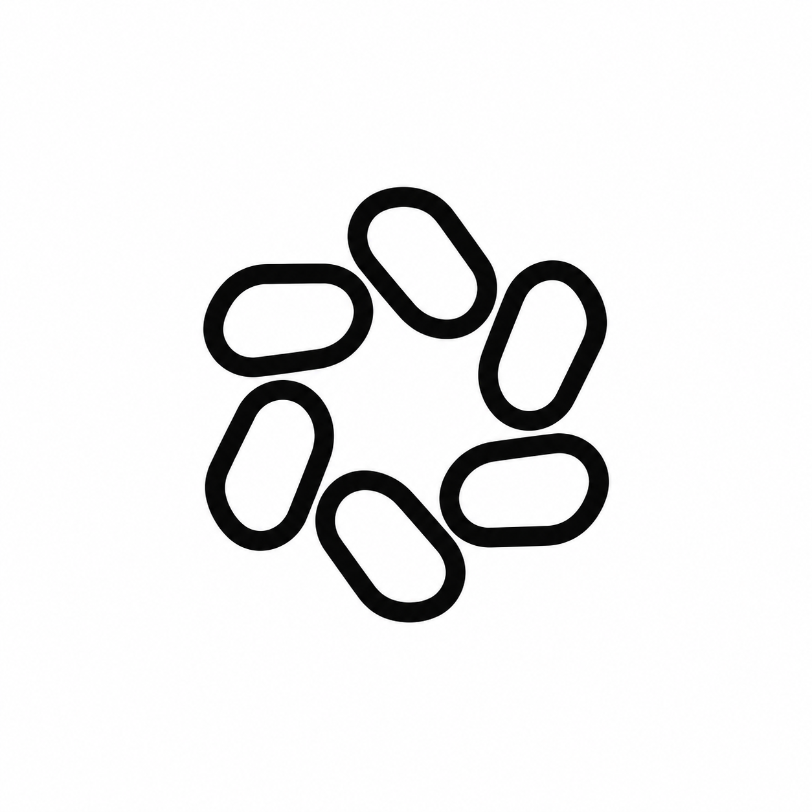
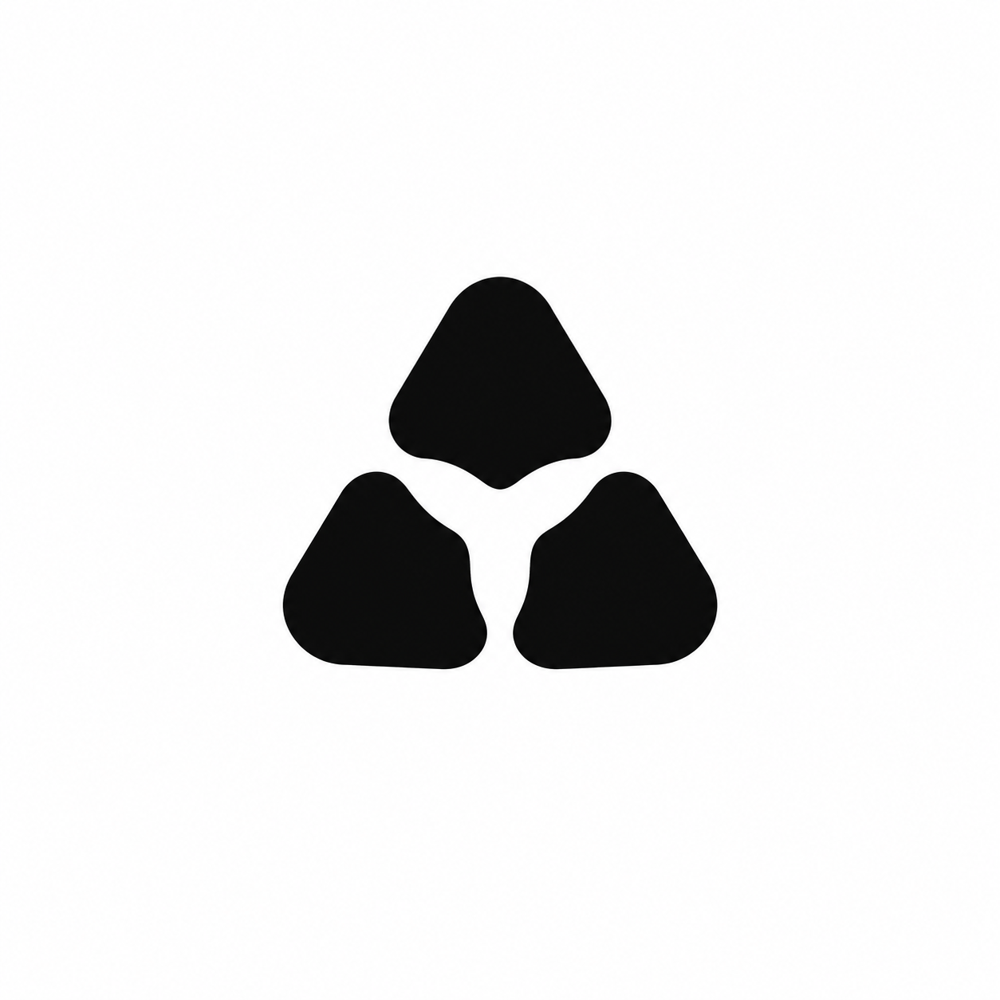
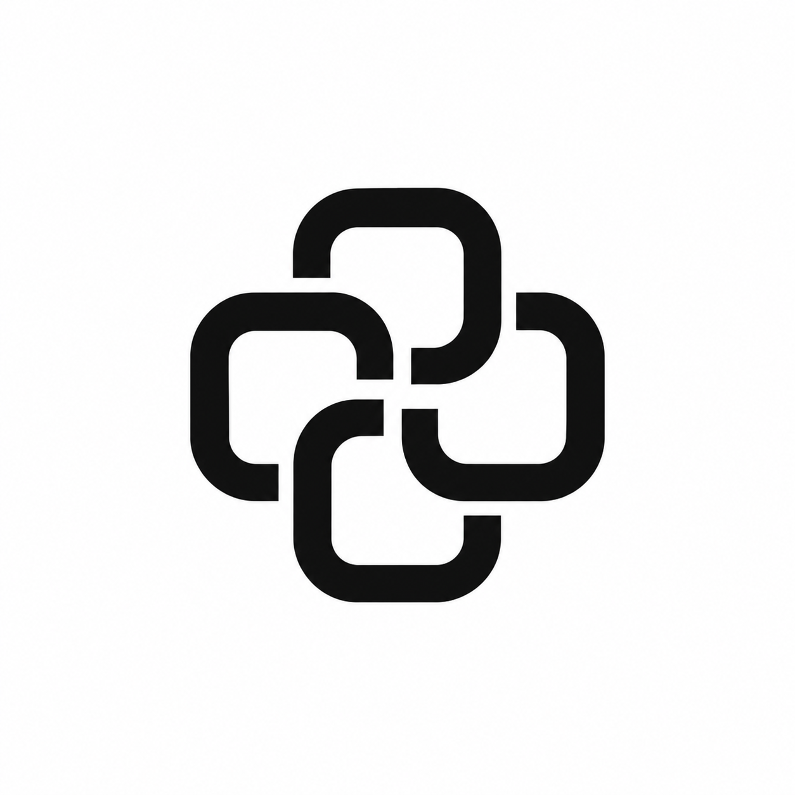
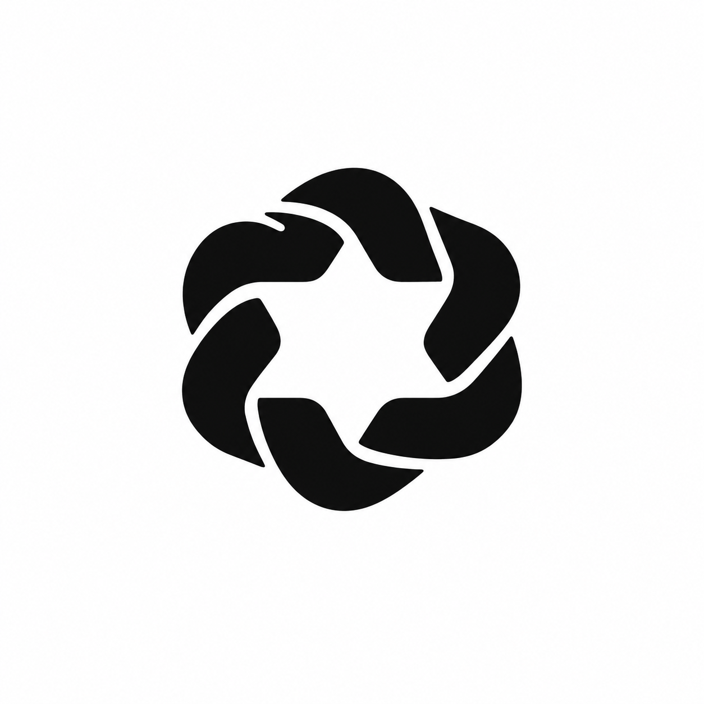

# Geometric rhythm exploration

Second round, generated using the built-in image generation tool. The user rejected the first round and supplied Midday, Factory, Devin, Partly, and OpenAI logos as visual references. This round explores repetition, symmetry, lighter construction, and negative space. All concepts remain unselected raster explorations; exact geometry and small-size legibility require refinement after selection.

## Spindle

Use case: logo-brand. Design a refined minimal geometric logo icon for Perpeto, an intelligent software factory named for perpetual motion. The previous concepts were rejected as heavy, blocky, generic industrial symbols. This round must feel elegant, rhythmic, compact, balanced, and beautifully simple. Visual taste: the precision and optical balance of leading modern technology identities, radial repetition, carefully controlled negative space. Original design, not a copy of OpenAI knot, Factory flower, Midday sun, Devin or Partly. Pure black geometry on pure white square background. One centered icon about 40 percent of canvas width, ample white margins. Flat vector-like clean edges. Medium-weight construction, never bulky. No text, wordmark, labels, gradients, shadows, textures, 3D, mockup, arrows, cog teeth, literal infinity symbol. A delicate but readable kinetic rosette made from exactly eight identical gently bent spokes rotated evenly around a small open center. Each spoke consists of two straight segments with a softly rounded elbow, like precisely bent wire. Consistent medium stroke with rounded caps. Clear separated arms, no overlaps. Graceful rotational rhythm, a small intelligent mechanism. Avoid looking like an asterisk with straight rays or a flower with petals.

## Lattice

Use case: logo-brand. Design a refined minimal geometric logo icon for Perpeto, an intelligent software factory named for perpetual motion. The previous concepts were rejected as heavy, blocky, generic industrial symbols. This round must feel elegant, rhythmic, compact, balanced, and beautifully simple. Visual taste: the precision and optical balance of leading modern technology identities, radial repetition, carefully controlled negative space. Original design, not a copy of OpenAI knot, Factory flower, Midday sun, Devin or Partly. Pure black geometry on pure white square background. One centered icon about 40 percent of canvas width, ample white margins. Flat vector-like clean edges. Medium-weight construction, never bulky. No text, wordmark, labels, gradients, shadows, textures, 3D, mockup, arrows, cog teeth, literal infinity symbol. A compact sixfold geometric loop made from exactly six identical narrow rounded lozenges arranged radially, each leaning tangentially, sharing an orderly open hexagonal center. Outline construction with consistent medium stroke, visually simple, beautiful sixfold symmetry. Single flat plane with no weaving or over-under knot. The result feels like a precision geometric optical instrument, airy rather than heavy.

## Triad

Use case: logo-brand. Design a refined minimal geometric logo icon for Perpeto, an intelligent software factory named for perpetual motion. The previous concepts were rejected as heavy, blocky, generic industrial symbols. This round must feel elegant, rhythmic, compact, balanced, and beautifully simple. Visual taste: the precision and optical balance of leading modern technology identities, radial repetition, carefully controlled negative space. Original design, not a copy of OpenAI knot, Factory flower, Midday sun, Devin or Partly. Pure black geometry on pure white square background. One centered icon about 40 percent of canvas width, ample white margins. Flat vector-like clean edges. Medium-weight construction, never bulky. No text, wordmark, labels, gradients, shadows, textures, 3D, mockup, arrows, cog teeth, literal infinity symbol. Exactly three identical small solid rounded triangular modules arranged with 120-degree rotational symmetry. Their inward-facing concave cuts jointly define a beautiful small three-lobed negative space. Compact unified silhouette with narrow clean white gaps between the three units. Extremely simple, not a recycling sign, not three arrows, not a cube. Soft precision, intelligent coordination.

## Relay

Use case: logo-brand. Design a refined minimal geometric logo icon for Perpeto, an intelligent software factory named for perpetual motion. The previous concepts were rejected as heavy, blocky, generic industrial symbols. This round must feel elegant, rhythmic, compact, balanced, and beautifully simple. Visual taste: the precision and optical balance of leading modern technology identities, radial repetition, carefully controlled negative space. Original design, not a copy of OpenAI knot, Factory flower, Midday sun, Devin or Partly. Pure black geometry on pure white square background. One centered icon about 40 percent of canvas width, ample white margins. Flat vector-like clean edges. Medium-weight construction, never bulky. No text, wordmark, labels, gradients, shadows, textures, 3D, mockup, arrows, cog teeth, literal infinity symbol. Four identical open rounded-square loops rotated around a small central square void, arranged as a compact fourfold symmetric mechanical rosette. Consistent medium-weight outline, each unit has one precisely placed opening so the whole mark suggests ongoing circulation. Keep only four parts and a few clean intersections, not tangled. Airy clean silhouette, exquisite proportions, approachable industrial precision.

## Iris

Use case: logo-brand. Design a refined minimal geometric logo icon for Perpeto, an intelligent software factory named for perpetual motion. The previous concepts were rejected as heavy, blocky, generic industrial symbols. This round must feel elegant, rhythmic, compact, balanced, and beautifully simple. Visual taste: the precision and optical balance of leading modern technology identities, radial repetition, carefully controlled negative space. Original design, not a copy of OpenAI knot, Factory flower, Midday sun, Devin or Partly. Pure black geometry on pure white square background. One centered icon about 40 percent of canvas width, ample white margins. Flat vector-like clean edges. Medium-weight construction, never bulky. No text, wordmark, labels, gradients, shadows, textures, 3D, mockup, arrows, cog teeth, literal infinity symbol. A six-sided soft geometric ring formed from six identical short curved bands, evenly rotated in a precise radial arrangement, defining a crisp six-point star-shaped negative space in the center. Small narrow gaps separate the bands. Outer silhouette is subtly scalloped and almost circular, not a hex nut or gear. Medium weight, spacious center, perfectly balanced symmetry. Original simple compact mark with a quiet sense of endless motion.
