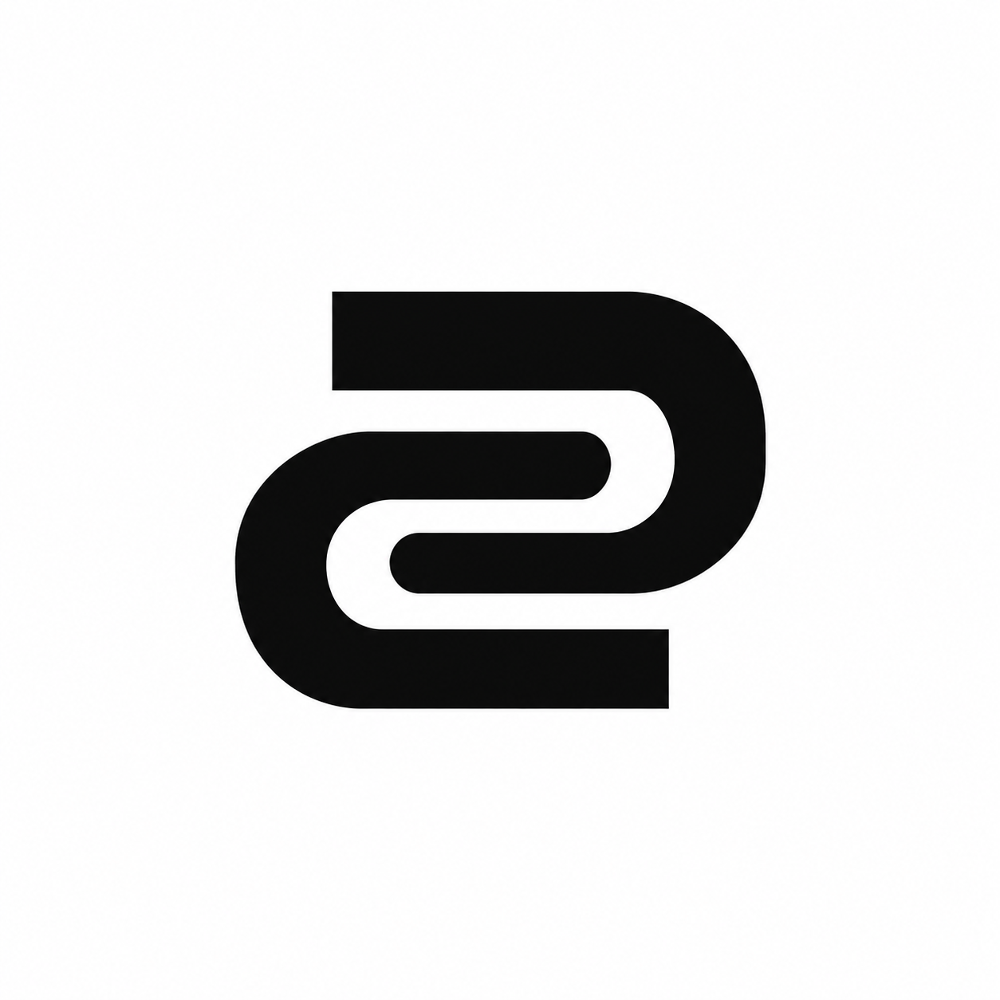
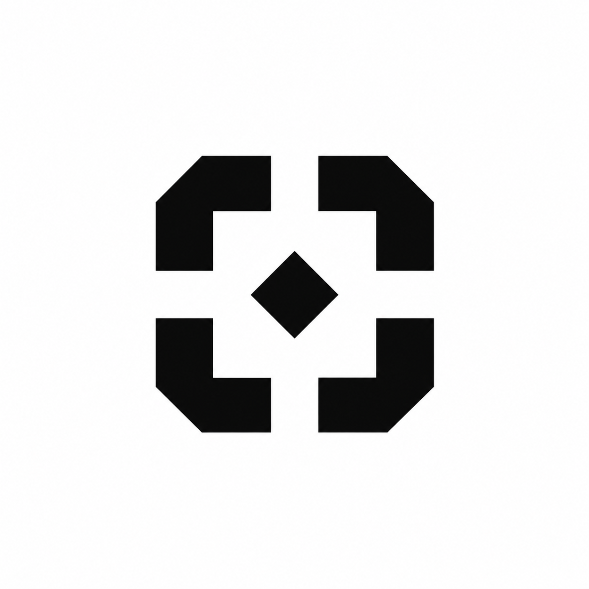
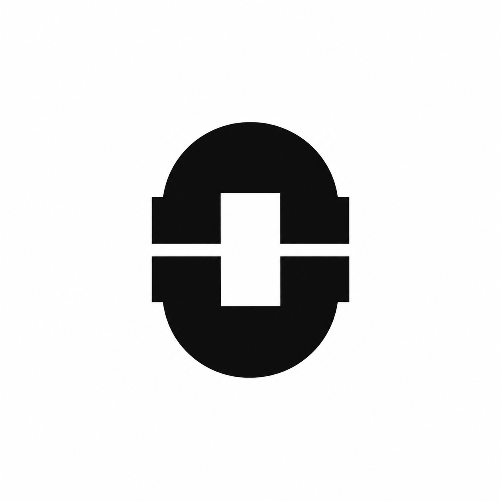
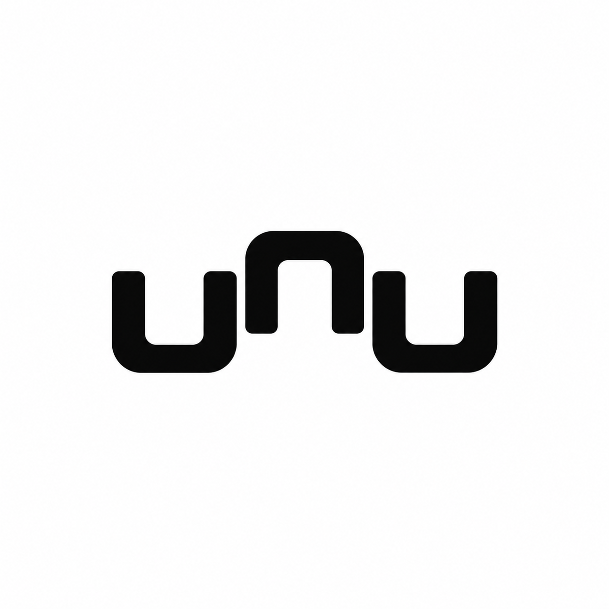

# Industrial AI identity research and new concepts

Reviewed official homepages visually on 2026-10-17. This is a focused design study of five relevant companies, not an exhaustive market or trademark review.

| Company | Observed identity | Design lesson |
| --- | --- | --- |
| [Factory](https://factory.com/) | Black outlined repeating rosette with uppercase sans wordmark | Repetition can suggest coordinated activity without literal machinery |
| [Augury](https://www.augury.com/) | Wave-like line emblem above uppercase name | A single dynamic gesture can carry a technical identity |
| [Physical Intelligence](https://www.pi.website/) | Serif name with parenthesized pi notation | Mathematical meaning and restraint can carry the identity without a complex icon |
| [Intrinsic](https://www.intrinsic.ai/) | Simple lowercase sans wordmark in the homepage header | Industrial context can come from the surrounding system and imagery |
| [Bright Machines](https://www.brightmachines.com/) | White dot pattern in a red square beside a stacked name | Repeated small units can create one recognizable manufacturing identity |

The design lessons are interpretations of the visible logos, not claims about their creators' intent. The five concepts below explore different constructions from the Spindle family. All were made with the built-in image generation tool. They remain raster explorations; no new favorite has been assumed. The exact eight-arm favorite is preserved in [the shortlist](../../shortlist/README.md).

## Concepts and exact prompts

### Shuttle

Use case: logo-brand. Create one completely new logo ICON for Perpeto, an open-source intelligent software factory named after perpetual motion. A premium minimal modern industrial identity. Research direction: successful industrial AI identities use a single memorable abstract construction, disciplined repetition, clean negative space and visual restraint. Original design, do not reproduce Factory's flower, Bright Machines' dot pattern, Augury's wave or Physical Intelligence's pi. Also do NOT create another radial bent-spoke turbine, gear, flower, sun, infinity sign or three-part triangular mark: those have already been explored. Flat pure black mark on white square, centered about 45 percent canvas width, generous whitespace. Crisp vector-like geometry, balanced proportions and medium weight, recognizable at small size. Icon only, no text, labels, gradients, texture, shadows, 3D or mockups. Two thick parallel horizontal racetrack-shaped paths, each open on the opposite end, nested tightly to form a compact continuous-motion mechanism. A precise central white slot connects the two paths visually. Simple rounded returns and straight machined rails. Overall compact almost-square silhouette with bilateral balance. A subtle abstract S suggested by negative space, not a literal letter. Two parts only, no small details.

### Fixture

Use case: logo-brand. Create one completely new logo ICON for Perpeto, an open-source intelligent software factory named after perpetual motion. A premium minimal modern industrial identity. Research direction: successful industrial AI identities use a single memorable abstract construction, disciplined repetition, clean negative space and visual restraint. Original design, do not reproduce Factory's flower, Bright Machines' dot pattern, Augury's wave or Physical Intelligence's pi. Also do NOT create another radial bent-spoke turbine, gear, flower, sun, infinity sign or three-part triangular mark: those have already been explored. Flat pure black mark on white square, centered about 45 percent canvas width, generous whitespace. Crisp vector-like geometry, balanced proportions and medium weight, recognizable at small size. Icon only, no text, labels, gradients, texture, shadows, 3D or mockups. Four identical short angular brackets positioned at the corners of an invisible square, facing inward, their tips stopping with equal white gaps around a small central diamond-shaped aperture. Each bracket is one solid bent shape with a subtly chamfered exterior corner. Compact precision jig or alignment fixture feeling. Fourfold symmetry, not rotational pinwheel, no diagonal spokes. Strong static balance and engineered modularity.

### Loom

Use case: logo-brand. Create one completely new logo ICON for Perpeto, an open-source intelligent software factory named after perpetual motion. A premium minimal modern industrial identity. Research direction: successful industrial AI identities use a single memorable abstract construction, disciplined repetition, clean negative space and visual restraint. Original design, do not reproduce Factory's flower, Bright Machines' dot pattern, Augury's wave or Physical Intelligence's pi. Also do NOT create another radial bent-spoke turbine, gear, flower, sun, infinity sign or three-part triangular mark: those have already been explored. Flat pure black mark on white square, centered about 45 percent canvas width, generous whitespace. Crisp vector-like geometry, balanced proportions and medium weight, recognizable at small size. Icon only, no text, labels, gradients, texture, shadows, 3D or mockups. A single compact emblem of three broad parallel diagonal strips interleaved with two short opposing strips using only two deliberate white interruptions. A minimal abstract woven joint suggesting independent work becoming one structure. Overall silhouette a neatly cropped diamond with softened corner tips, flat planar geometry, not a 3D cube, not a knot, not a hashtag. Few broad pieces, exact even spacing.

### Press

Use case: logo-brand. Create one completely new logo ICON for Perpeto, an open-source intelligent software factory named after perpetual motion. A premium minimal modern industrial identity. Research direction: successful industrial AI identities use a single memorable abstract construction, disciplined repetition, clean negative space and visual restraint. Original design, do not reproduce Factory's flower, Bright Machines' dot pattern, Augury's wave or Physical Intelligence's pi. Also do NOT create another radial bent-spoke turbine, gear, flower, sun, infinity sign or three-part triangular mark: those have already been explored. Flat pure black mark on white square, centered about 45 percent canvas width, generous whitespace. Crisp vector-like geometry, balanced proportions and medium weight, recognizable at small size. Icon only, no text, labels, gradients, texture, shadows, 3D or mockups. Two opposing solid arch-shaped components aligned vertically, one above the other, forming an enclosed small square white aperture between them. Top and bottom pieces separated by a narrow horizontal white seam. Each component has one smooth outer semicircular shoulder and two short straight feet. Abstract precision die or press, soft industrial strength. Compact upright silhouette, just two components, no dots, no radial arrangement.

### Phase

Use case: logo-brand. Create one completely new logo ICON for Perpeto, an open-source intelligent software factory named after perpetual motion. A premium minimal modern industrial identity. Research direction: successful industrial AI identities use a single memorable abstract construction, disciplined repetition, clean negative space and visual restraint. Original design, do not reproduce Factory's flower, Bright Machines' dot pattern, Augury's wave or Physical Intelligence's pi. Also do NOT create another radial bent-spoke turbine, gear, flower, sun, infinity sign or three-part triangular mark: those have already been explored. Flat pure black mark on white square, centered about 45 percent canvas width, generous whitespace. Crisp vector-like geometry, balanced proportions and medium weight, recognizable at small size. Icon only, no text, labels, gradients, texture, shadows, 3D or mockups. Three short identical squared U-shaped strokes placed side by side, each offset vertically by a small equal step, forming a compact rhythmic stepped emblem. Middle U inverted, others upright, with exactly consistent medium stroke width and small rounded elbows. Suggest synchronized machine cycles and continuous production, like a beautifully simplified timing diagram. Width only slightly greater than height, clean negative spaces, not a bar chart, not a circuit board, no enclosing frame.
