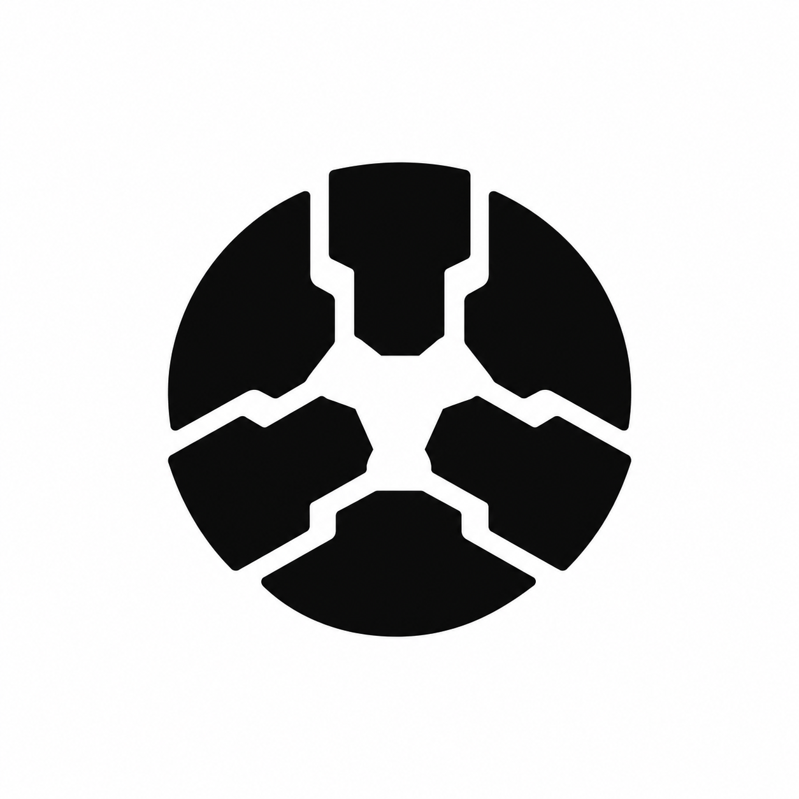
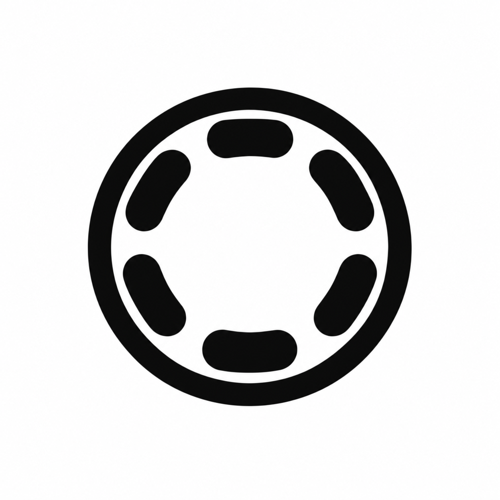
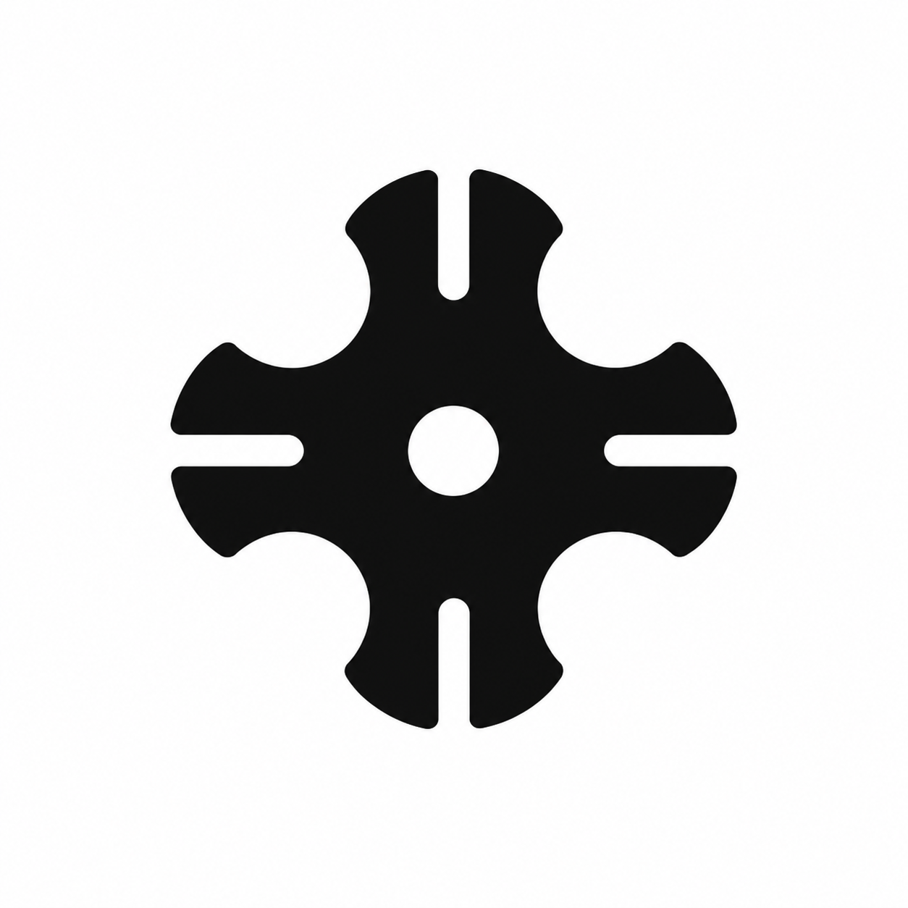
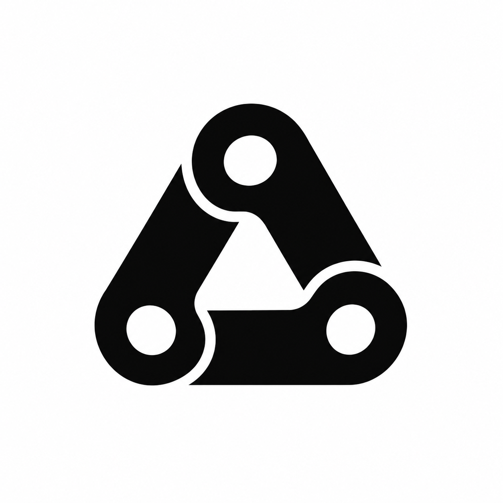

# Mechanical logo exploration

Third round: retain geometric repetition while grounding the forms in industrial mechanisms. Generated with the built-in image generation tool. Unselected raster concepts, not finished vector assets or engineering diagrams. The Impeller generation was blocked by the image tool; Rotor was generated as the fifth concept.

## Chuck

Use case: logo-brand. Create one original geometric logo ICON for Perpeto, an intelligent software factory named after perpetuum mobile. The user likes elegant radial repetition, symmetry, negative space and clean modern tech logos, but wants a more inherently INDUSTRIAL mechanical identity. Distill a real precision machine component into an exceptionally simple memorable logo. Flat solid black on white square canvas, centered mark about 45 percent canvas width with generous white margins. Mathematically disciplined, medium weight, balanced open spaces, clean vector-like edges. No words, labels, numbers, gradients, textures, shadows, 3D, perspective, mockups, literal factory building, generic cogwheel, arrows, infinity sign, decorative petals, tech circuitry. Must feel like an engineered component rather than a flower or generic AI sparkle. Original design, do not copy existing brands. Inspired by a three-jaw self-centering lathe chuck seen straight on. Exactly three identical compact stepped jaw shapes arranged at 120 degrees, their inward tips defining a small precise triangular central opening. Each jaw has one broad curved outer shoulder and a crisp machined inner step. Three separate pieces with consistent white clearance channels, tight circular overall silhouette. Visibly clamping and coordinated mechanical movement, simple enough for a favicon. No surrounding ring, no screws or bolts.

## Bearing

Use case: logo-brand. Create one original geometric logo ICON for Perpeto, an intelligent software factory named after perpetuum mobile. The user likes elegant radial repetition, symmetry, negative space and clean modern tech logos, but wants a more inherently INDUSTRIAL mechanical identity. Distill a real precision machine component into an exceptionally simple memorable logo. Flat solid black on white square canvas, centered mark about 45 percent canvas width with generous white margins. Mathematically disciplined, medium weight, balanced open spaces, clean vector-like edges. No words, labels, numbers, gradients, textures, shadows, 3D, perspective, mockups, literal factory building, generic cogwheel, arrows, infinity sign, decorative petals, tech circuitry. Must feel like an engineered component rather than a flower or generic AI sparkle. Original design, do not copy existing brands. Inspired by a precision roller bearing viewed straight on. One medium-weight circular outer race enclosing exactly six small solid short capsule-shaped rollers arranged evenly around a generous empty circular center. Rollers oriented tangentially, precisely separated from the outer ring. Only the outer ring and six rollers, no inner ring, no axle, no additional detail. Compact, elegant mechanical symmetry, instantly suggests a moving engineered assembly.

## Geneva

Use case: logo-brand. Create one original geometric logo ICON for Perpeto, an intelligent software factory named after perpetuum mobile. The user likes elegant radial repetition, symmetry, negative space and clean modern tech logos, but wants a more inherently INDUSTRIAL mechanical identity. Distill a real precision machine component into an exceptionally simple memorable logo. Flat solid black on white square canvas, centered mark about 45 percent canvas width with generous white margins. Mathematically disciplined, medium weight, balanced open spaces, clean vector-like edges. No words, labels, numbers, gradients, textures, shadows, 3D, perspective, mockups, literal factory building, generic cogwheel, arrows, infinity sign, decorative petals, tech circuitry. Must feel like an engineered component rather than a flower or generic AI sparkle. Original design, do not copy existing brands. Inspired by a four-slot Geneva drive indexing wheel, distilled into a single striking silhouette. Four identical broad rounded lobes arranged at 90 degrees, with deep concave circular scoops between lobes and narrow straight radial slots cut into the outer end of each lobe. Small circular center hole. A real indexing mechanism rendered as an elegant geometric emblem. Rounded precision-machined outer contour, not a sharp cross, not a gear, not a flower. Keep all slots wide enough to read at icon size.

## Track

Use case: logo-brand. Create one original geometric logo ICON for Perpeto, an intelligent software factory named after perpetuum mobile. The user likes elegant radial repetition, symmetry, negative space and clean modern tech logos, but wants a more inherently INDUSTRIAL mechanical identity. Distill a real precision machine component into an exceptionally simple memorable logo. Flat solid black on white square canvas, centered mark about 45 percent canvas width with generous white margins. Mathematically disciplined, medium weight, balanced open spaces, clean vector-like edges. No words, labels, numbers, gradients, textures, shadows, 3D, perspective, mockups, literal factory building, generic cogwheel, arrows, infinity sign, decorative petals, tech circuitry. Must feel like an engineered component rather than a flower or generic AI sparkle. Original design, do not copy existing brands. Inspired by a closed industrial roller-chain drive, simplified into a compact rounded triangular circuit made of exactly three interlocking elongated rounded links. Bold consistent outline, precise straight segments and semicircular ends. A clear triangular central void and a restrained sense of continuous mechanically linked motion. Flat planar chain construction, no perspective, no intricate weaving, no extra dots, no literal infinity symbol. It should look like a beautifully reduced transmission component.

## Rotor

Design a simple black and white brand logo icon for a software project called Perpeto. Icon only, no text. A minimal abstract mechanical rotor: five identical short rounded rectangular paddles evenly spaced around an open pentagonal center. Fivefold rotational symmetry, precise consistent gaps, clean medium-weight geometry. Industrial precision and continuous motion. Flat black shapes on white background with generous margins. No gradients, no shading, no texture, no photorealism. The result should be a refined compact geometric symbol, not a technical illustration.
