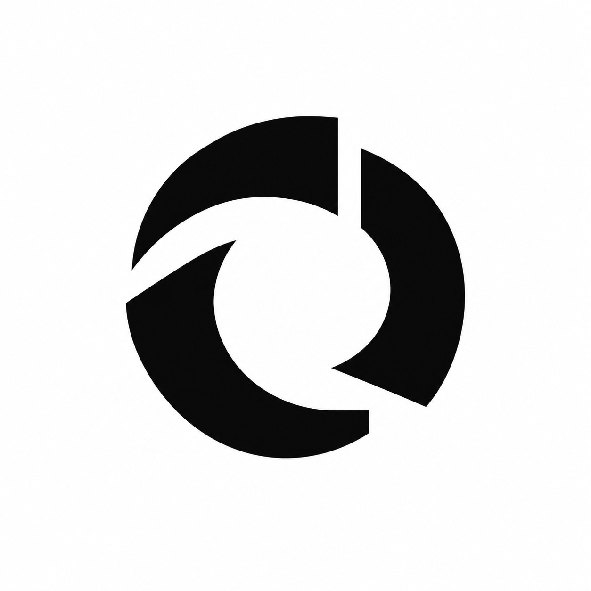
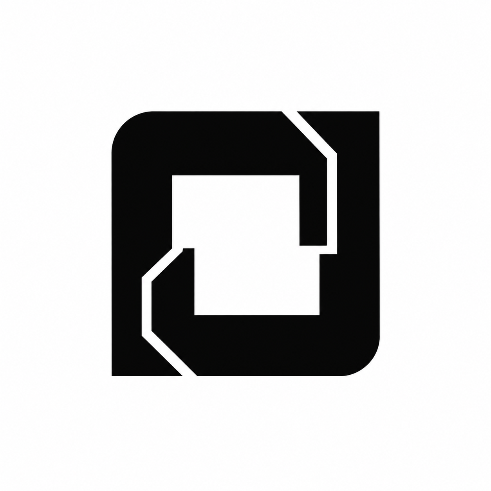
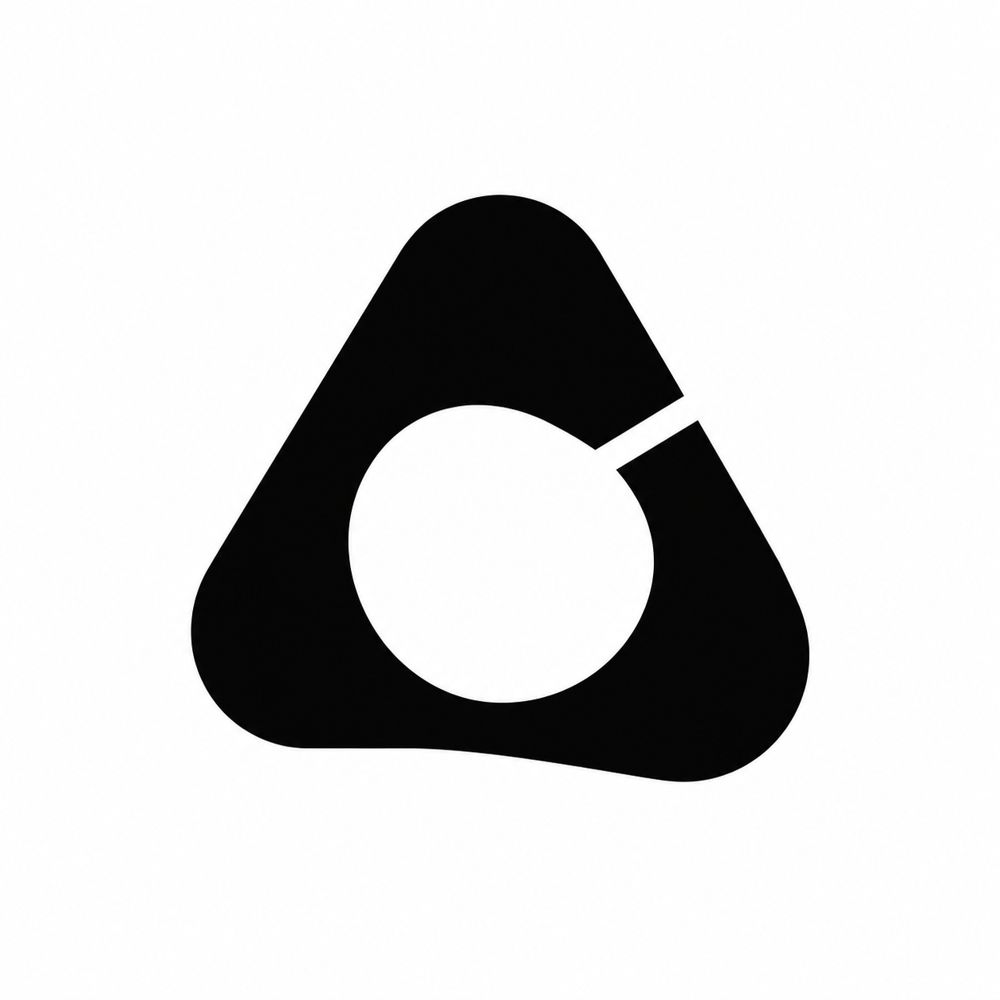
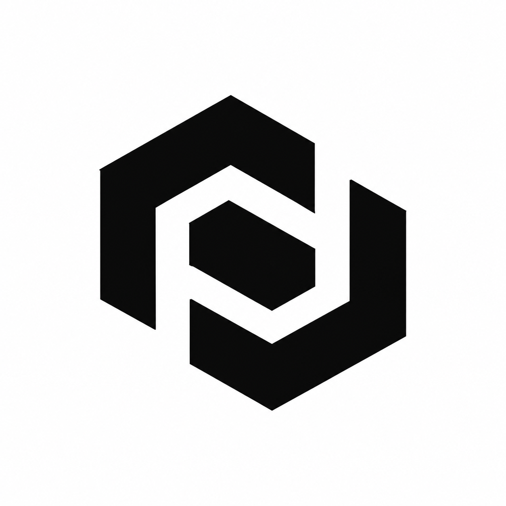
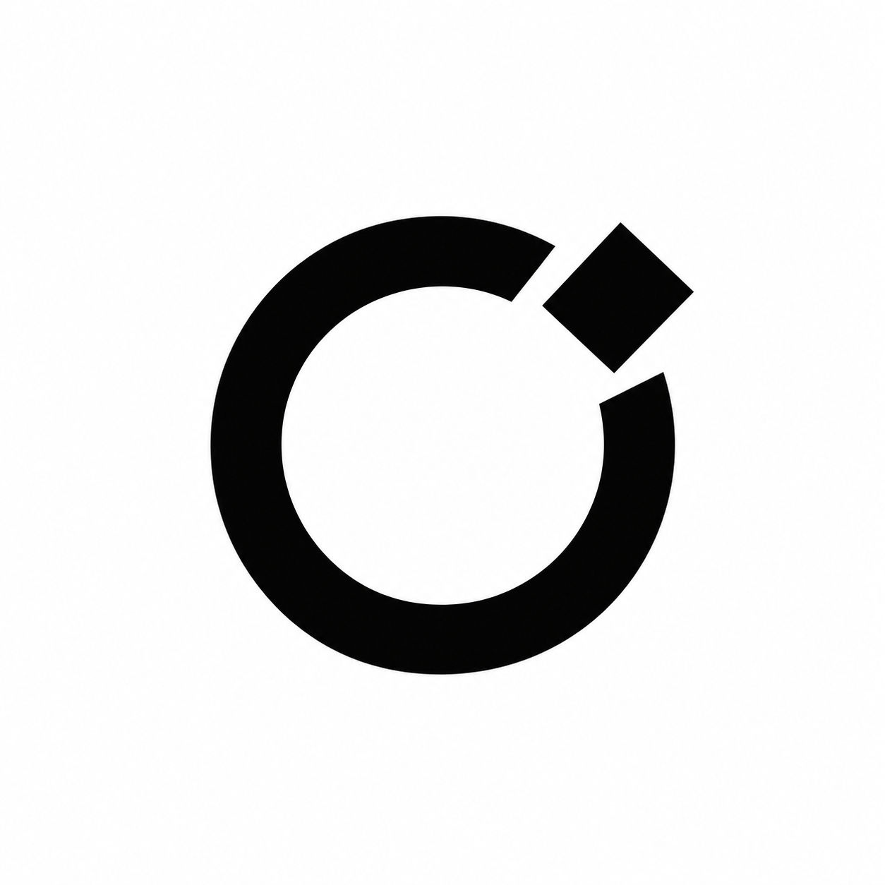

# Perpetual motion logo exploration

Five unselected raster concepts generated with the built-in image generation tool. These are exploratory marks, not final vector logos.

## Brief

Perpeto is named after perpetuum mobile. The user's direction is clean, minimal, modern and industrial: mechanical intelligence, perpetual motion and unlimited possibilities. Factory and Midday screenshots supplied visual mood references. No direction has been selected yet.

## Concepts and exact prompts

### Flywheel

Use case: logo-brand. Create one simple geometric logo ICON ONLY for Perpeto, an open-source intelligent software factory named after perpetuum mobile, the perpetual motion machine. Mood: extremely clean, minimal, modern, industrial, intelligent, endless possibility. Flat solid black on pure white square background, crisp vector-like geometry, generous whitespace, centered icon occupying about 45% of canvas. Bold enough for tiny favicon use. No typography, no labels, no mockups, no gradients, no shadows, no texture, no 3D, no robot, brain, circuit traces, stock gear wheel, arrows or literal infinity sign. Original identity, not a copy of Factory or Midday symbols. A precision flywheel abstracted into three substantial curved segments arranged around a generous empty circular hub. The segments have square machined ends and controlled asymmetric cuts suggesting continuous rotation. Compact strong circular silhouette; only three components; restrained and balanced, not a flower.

### Return

Use case: logo-brand. Create one simple geometric logo ICON ONLY for Perpeto, an open-source intelligent software factory named after perpetuum mobile, the perpetual motion machine. Mood: extremely clean, minimal, modern, industrial, intelligent, endless possibility. Flat solid black on pure white square background, crisp vector-like geometry, generous whitespace, centered icon occupying about 45% of canvas. Bold enough for tiny favicon use. No typography, no labels, no mockups, no gradients, no shadows, no texture, no 3D, no robot, brain, circuit traces, stock gear wheel, arrows or literal infinity sign. Original identity, not a copy of Factory or Midday symbols. A continuous square mechanical return path built from a single thick folded band, with one clever white break revealing its interlocking construction. Orthogonal industrial geometry with just two softened corners. Suggest an impossible endless assembly conveyor in flat two-dimensional geometry, not a perspective Penrose triangle. Compact square silhouette.

### Cam

Use case: logo-brand. Create one simple geometric logo ICON ONLY for Perpeto, an open-source intelligent software factory named after perpetuum mobile, the perpetual motion machine. Mood: extremely clean, minimal, modern, industrial, intelligent, endless possibility. Flat solid black on pure white square background, crisp vector-like geometry, generous whitespace, centered icon occupying about 45% of canvas. Bold enough for tiny favicon use. No typography, no labels, no mockups, no gradients, no shadows, no texture, no 3D, no robot, brain, circuit traces, stock gear wheel, arrows or literal infinity sign. Original identity, not a copy of Factory or Midday symbols. An abstract mechanical cam: one bold rounded triangular outer body, with a precisely offset circular negative-space aperture. A single small straight notch in the perimeter adds engineered intent. Fewest possible geometric elements. Tension between rotation and equilibrium. Distinctive solid compact silhouette.

### Coupling

Use case: logo-brand. Create one simple geometric logo ICON ONLY for Perpeto, an open-source intelligent software factory named after perpetuum mobile, the perpetual motion machine. Mood: extremely clean, minimal, modern, industrial, intelligent, endless possibility. Flat solid black on pure white square background, crisp vector-like geometry, generous whitespace, centered icon occupying about 45% of canvas. Bold enough for tiny favicon use. No typography, no labels, no mockups, no gradients, no shadows, no texture, no 3D, no robot, brain, circuit traces, stock gear wheel, arrows or literal infinity sign. Original identity, not a copy of Factory or Midday symbols. Two identical substantial angular C-shaped links rotated 180 degrees relative to each other and nested into a single compact mark, separated by a clean uniform white channel. Suggest coordinated parts passing motion endlessly. Flat orthogonal geometry, strong negative space, a subtle industrial monogram feel without a literal letter.

### Orbit

Use case: logo-brand. Create one simple geometric logo ICON ONLY for Perpeto, an open-source intelligent software factory named after perpetuum mobile, the perpetual motion machine. Mood: extremely clean, minimal, modern, industrial, intelligent, endless possibility. Flat solid black on pure white square background, crisp vector-like geometry, generous whitespace, centered icon occupying about 45% of canvas. Bold enough for tiny favicon use. No typography, no labels, no mockups, no gradients, no shadows, no texture, no 3D, no robot, brain, circuit traces, stock gear wheel, arrows or literal infinity sign. Original identity, not a copy of Factory or Midday symbols. A minimal kinetic bearing: a thick open circular ring with a single detached solid square precisely seated in its opening, the square slightly rotated to suggest forward movement. Only two black components. Precise intentional proportions and negative space. A machine capable of continuing indefinitely. No orbit lines, no small dots, no astronomy motifs.
