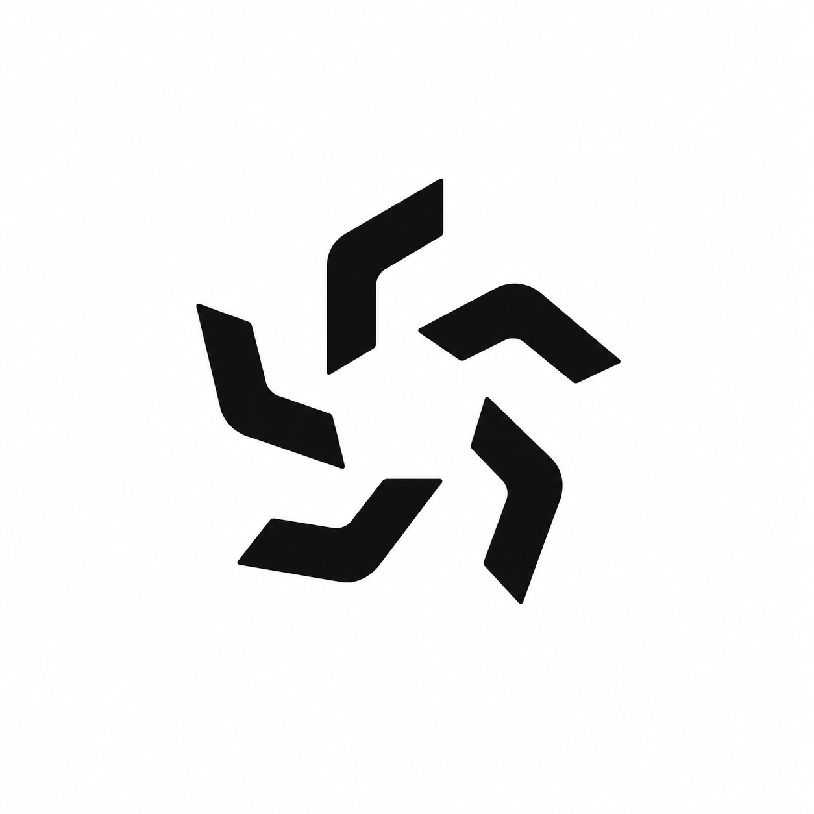
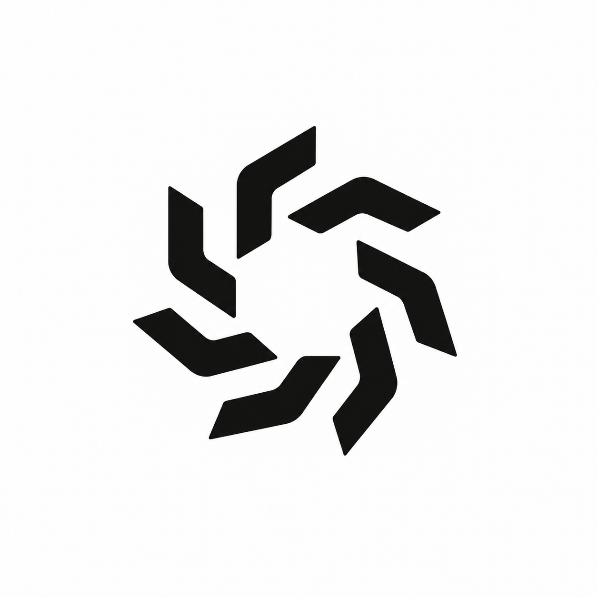

# Spindle arm counts

Generated raster explorations using the built-in image generation tool. The confirmed reference direction is Spindle Six, not Triad Socket. No final variant selected; exact symmetry still needs vector refinement.

## Five arms

Edit the provided Perpeto logo. Preserve the same bent-chevron arm design, black weight, softly rounded elbow, diagonal flat-cut ends, rotational handedness and minimalist industrial aesthetic. Change ONLY the number of repeated arms and their evenly spaced radial arrangement. Every arm must be an identical rotated copy, separate from its neighbors, surrounding a generous open center. All arms should have consistent thickness and length, and equal angular spacing. Keep the whole mark centered with generous white margins. Pure black on white, flat clean vector-like geometry, no text, labels, shadows, gradients, texture, outlines, circles, additional shapes or perspective. Show EXACTLY 5 separate bent arms, at equal 72 degree rotational intervals. Count the arms carefully: exactly 5, not six. Adjust their radial distance only as needed to leave clear even gaps. This is a 5-fold symmetric logo.

## Seven arms

Edit the provided Perpeto logo. Preserve the same bent-chevron arm design, black weight, softly rounded elbow, diagonal flat-cut ends, rotational handedness and minimalist industrial aesthetic. Change ONLY the number of repeated arms and their evenly spaced radial arrangement. Every arm must be an identical rotated copy, separate from its neighbors, surrounding a generous open center. All arms should have consistent thickness and length, and equal angular spacing. Keep the whole mark centered with generous white margins. Pure black on white, flat clean vector-like geometry, no text, labels, shadows, gradients, texture, outlines, circles, additional shapes or perspective. Show EXACTLY 7 separate bent arms, at equal 51.42857142857143 degree rotational intervals. Count the arms carefully: exactly 7, not six. Adjust their radial distance only as needed to leave clear even gaps. This is a 7-fold symmetric logo.

## Eight arms

Edit the provided Perpeto logo. Preserve the same bent-chevron arm design, black weight, softly rounded elbow, diagonal flat-cut ends, rotational handedness and minimalist industrial aesthetic. Change ONLY the number of repeated arms and their evenly spaced radial arrangement. Every arm must be an identical rotated copy, separate from its neighbors, surrounding a generous open center. All arms should have consistent thickness and length, and equal angular spacing. Keep the whole mark centered with generous white margins. Pure black on white, flat clean vector-like geometry, no text, labels, shadows, gradients, texture, outlines, circles, additional shapes or perspective. Show EXACTLY 8 separate bent arms, at equal 45 degree rotational intervals. Count the arms carefully: exactly 8, not six. Adjust their radial distance only as needed to leave clear even gaps. This is a 8-fold symmetric logo.
