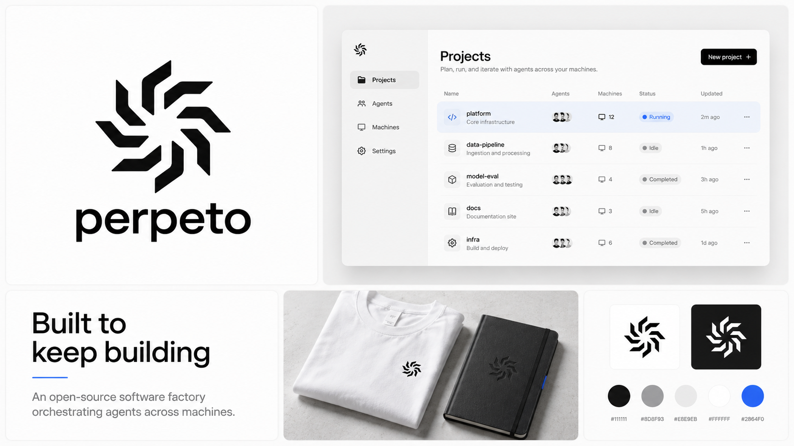
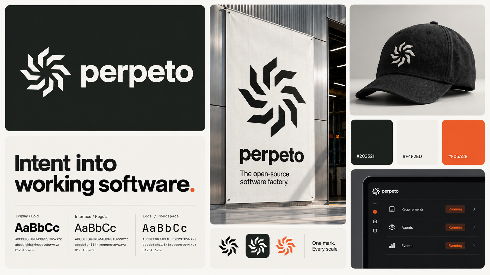

# Favorite Perpeto brand boards

These four boards were explicitly selected as favorites on 2026-10-17. They are preferred visual references, not a finalized choice of one brand system. Original explorations remain unchanged.

## Monochrome Orange

Source: `exec-ae4b6b7d-60db-44a9-b3c4-8c411e82b3c1.png`

## Monochrome Blue

Source: `exec-73dc1de1-df20-44cd-9dde-7e9cc7d6af87.png`

## Industrial Guidelines

Source: `exec-b3c19898-ce98-425d-9795-e8728bd334c5.png`

## Modular Grid

Source: `exec-31bc2060-d3f0-4af0-8fc4-a49abbb862c8.png`

Use the master SVG for exact logo geometry. Generated UI and claims are illustrative; the GitHub count in Modular Grid is not a real project metric.
