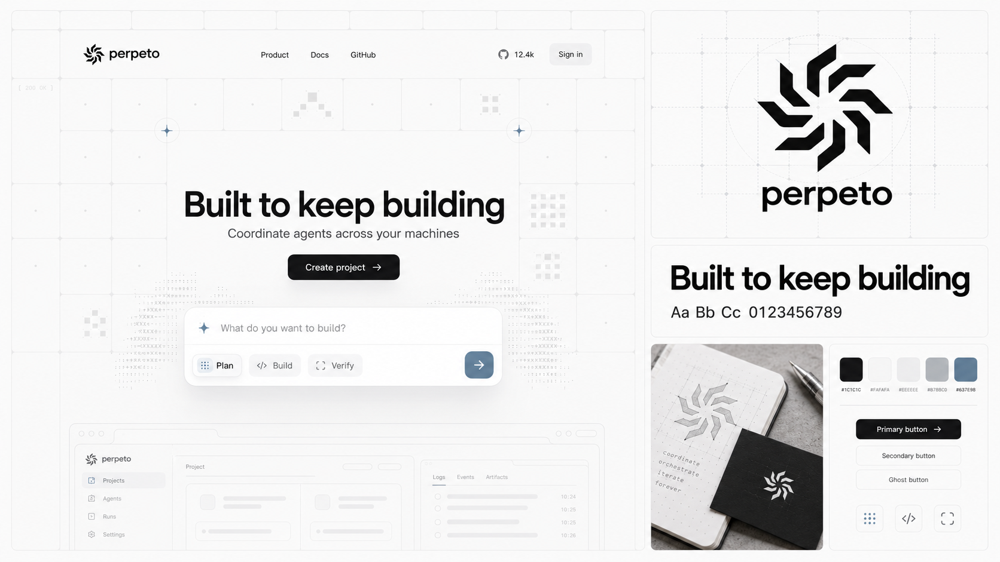

# Modular grid direction

Generated using the built-in image generation tool. Inspired by the supplied reference's modular grid, pale technical motifs, centered hero typography and floating composer, with a monochrome and muted slate-blue palette. Visual concept only. The generated GitHub count is fictitious and must not be used as a product claim. Use the original Spindle SVG for exact production geometry.

## Generation prompt

Create one premium landscape 16:9 Perpeto brand overview board, continuing the brand-overview exploration. Input image 1 is a DESIGN-LANGUAGE reference (Firecrawl page): borrow the faint large modular grid, subtly rounded grid cells, large centered bold sans-serif hero, fine hairline separators, tiny restrained pixel/ASCII-like motifs, sparse dot intersections, softly floating input panel and pale wireframe UI behind it. DO NOT copy its orange color, its flame logo, its brand name, its claims or copy. Input image 2 is the approved Perpeto Spindle logo; preserve its eight distinct bent angular arms, handedness and upright orientation faithfully. Use lowercase wordmark "perpeto" and exact headline "Built to keep building". This is a BRAND OVERVIEW COLLAGE in a polished asymmetric 5-panel layout, not only a website screenshot. The largest panel, roughly 60% of board on left, shows a flat clean website design for Perpeto using the reference's design language: pale graphite-on-white modular grid surrounding a spacious central hero, black Spindle logo with wordmark in header, navigation "Product", "Docs", "GitHub"; centered headline "Built to keep building"; short line "Coordinate agents across your machines"; black primary action "Create project"; floating rounded project-intent composer with prompt "What do you want to build?" and small options "Plan", "Build", "Verify", underlined fine UI details. Low-contrast pixel arrangements and very faint abstract ASCII texture ONLY on edges of hero, lots of blank space. No numbered eyebrow headings. Right side upper tile: large black logo and wordmark on white with miniature subtle gray construction grid. Right middle tile: exact headline in beautiful bold neutral sans and a small monochrome specimen "Aa Bb Cc 0123456789". Right lower two tiles: a photoreal white technical notebook and matte black card with small white Spindle stamped on it, plus a minimalist palette strip and small button samples. All surfaces dominated by white #FAFAFA, near-black #1C1C1C, grays #EEEEEE and #B7BBC0; allow only tiny desaturated slate blue #637E98 hints on an active UI dot and one palette swatch, absolutely no orange. Main wordmark/logo pure black or white. Soft restrained shadows only on floating composer and physical mockup. Crisp typesetting, extremely clean, precise friendly developer-tool visual language. No busy generic dashboard, no giant colored surfaces, no illustrations of robots, no extra logos. The board should visibly embody the supplied web reference's structured light grid aesthetic while being original Perpeto. Output a finished high-resolution brand concept image.
