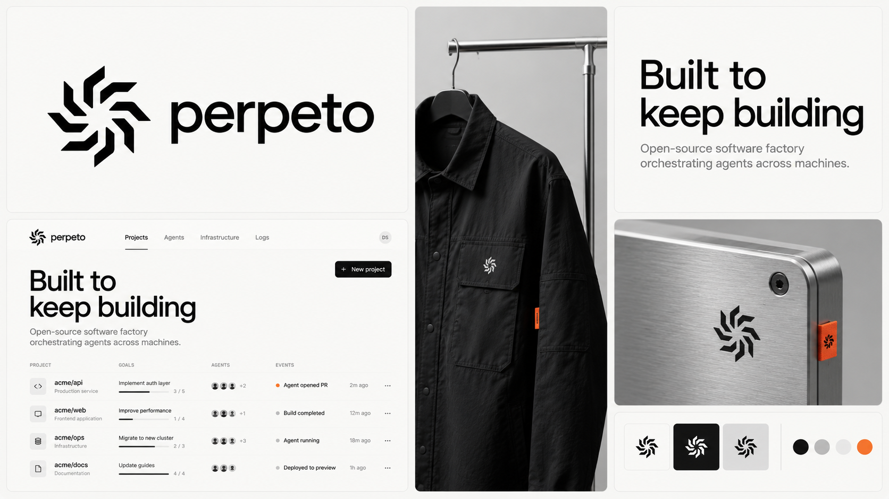
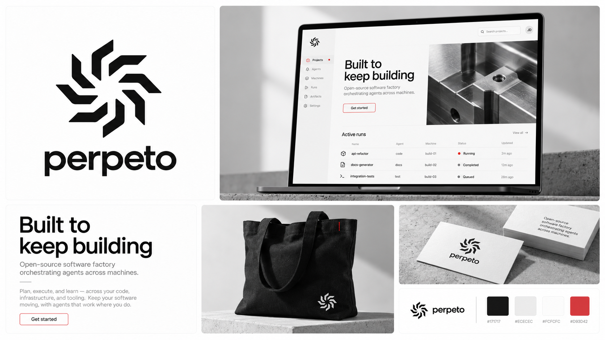
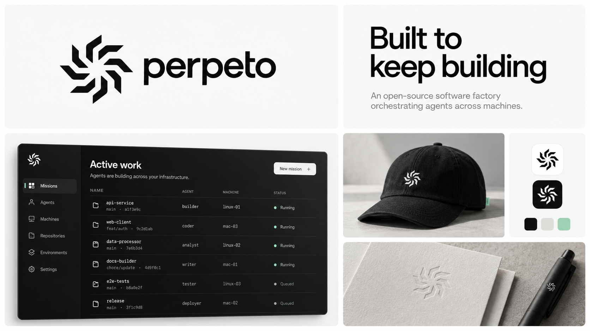
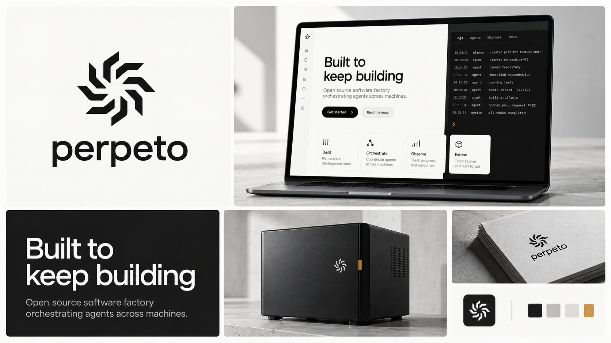

# Monochrome Perpeto explorations

Five concept boards generated with the built-in image generation tool. Based on user-supplied Factory, Devin and Partly visual references: restrained grayscale, generous whitespace and minimal accent details. The selected Spindle and Built to keep building are retained. These remain visual proposals, not approved implementation specifications; use the master SVG for exact logo geometry.

## mono-orange

### Generation prompt

Generate a premium landscape 16:9 Perpeto brand overview image. This is a clean brand overview collage, NOT a full website screenshot. Reference image 1 is the approved eight-arm angular Spindle logo: keep its geometry, eight separate bent arms, handedness and upright orientation consistent. Reference images 2-4 are mood references only: learn from their exceptional whitespace, restrained black/white typography, spare precise software interfaces and small accent details. Do not copy their brand names, logos or text. Perpeto is an open-source software factory orchestrating agents across machines. Keep lowercase wordmark "perpeto" and exact slogan "Built to keep building". Use an asymmetric grid of 5-6 generously sized rectangular tiles with thin gutters on a very light background, gently rounded corners, expansive whitespace, strong editorial alignment. Large logo/wordmark tile, website or desktop product mockup tile, typographic slogan tile, one tactile branded application, and a compact palette/small logo treatments tile. At least 95% of the visible image must be pure grayscale: white, near-white, gray, charcoal, black. Accent covers at most 5% of area, never an entire panel or garment. Logo and wordmark always black or white. Modern neutral sans typography, high legibility, simple short text. No colored backgrounds, no large color swatches, no gradients, no colored lighting, no oversized fashion logos, no busy lifestyle scenes, no robot imagery, no charts for decoration, no geometric filler. No numbered labels or tiny numbered eyebrow headings. Show a sophisticated actual brand system with photoreal material mockups and sharply rendered UI, not a moodboard of generic objects. Layout sophistication and quiet negative space are paramount. Do not include browser cookies or navigation copied from references.
Direction: Precision workshop. Accent safety orange #E66A37 used only for a tiny UI active dot, thin button outline, and small fabric seam tag. Main palette white #FAFAF8, ink #161616, gray #D9D9D5. Upper-left identity black on white; large lower-left mostly white software landing page presented flat, not in a laptop: simple navigation, large "Built to keep building", minimal project list with "Goals", "Agents", "Events". Tall middle tile black technical overshirt on a hanger with a very small white embroidered Spindle, museum-like studio light. Upper-right slogan in black on white with impeccable spacing. Lower-right closeup brushed aluminum plate engraved with logo and tiny orange edge tab. One narrow grayscale palette strip plus an orange dot. Clean industrial editorial character.

## mono-blue

### Generation prompt

Generate a premium landscape 16:9 Perpeto brand overview image. This is a clean brand overview collage, NOT a full website screenshot. Reference image 1 is the approved eight-arm angular Spindle logo: keep its geometry, eight separate bent arms, handedness and upright orientation consistent. Reference images 2-4 are mood references only: learn from their exceptional whitespace, restrained black/white typography, spare precise software interfaces and small accent details. Do not copy their brand names, logos or text. Perpeto is an open-source software factory orchestrating agents across machines. Keep lowercase wordmark "perpeto" and exact slogan "Built to keep building". Use an asymmetric grid of 5-6 generously sized rectangular tiles with thin gutters on a very light background, gently rounded corners, expansive whitespace, strong editorial alignment. Large logo/wordmark tile, website or desktop product mockup tile, typographic slogan tile, one tactile branded application, and a compact palette/small logo treatments tile. At least 95% of the visible image must be pure grayscale: white, near-white, gray, charcoal, black. Accent covers at most 5% of area, never an entire panel or garment. Logo and wordmark always black or white. Modern neutral sans typography, high legibility, simple short text. No colored backgrounds, no large color swatches, no gradients, no colored lighting, no oversized fashion logos, no busy lifestyle scenes, no robot imagery, no charts for decoration, no geometric filler. No numbered labels or tiny numbered eyebrow headings. Show a sophisticated actual brand system with photoreal material mockups and sharply rendered UI, not a moodboard of generic objects. Layout sophistication and quiet negative space are paramount. Do not include browser cookies or navigation copied from references.
Direction: Clear systems. Accent vivid blue #2864F0 only for one small interface selection, a short underline, and tiny stationery edge. Main palette optic white #FFFFFF, black #111111, silver gray #E8E9EB. Exceptionally airy, neutral grotesk typography with medium-weight headlines inspired by clean engineering software. Identity on white. A large flat application window with quiet sidebar "Projects", "Agents", "Machines", sparse project rows and one tiny blue selected status. A typography tile shows "Built to keep building" with room to breathe. Photoreal white folded cotton shirt with a small black logo and black notebook with small blind-embossed logo; absolutely no big blue panels. Palette white/black/grays with a tiny blue chip. Clean, calm, precise, not corporate stock imagery.

## mono-red

### Generation prompt

Generate a premium landscape 16:9 Perpeto brand overview image. This is a clean brand overview collage, NOT a full website screenshot. Reference image 1 is the approved eight-arm angular Spindle logo: keep its geometry, eight separate bent arms, handedness and upright orientation consistent. Reference images 2-4 are mood references only: learn from their exceptional whitespace, restrained black/white typography, spare precise software interfaces and small accent details. Do not copy their brand names, logos or text. Perpeto is an open-source software factory orchestrating agents across machines. Keep lowercase wordmark "perpeto" and exact slogan "Built to keep building". Use an asymmetric grid of 5-6 generously sized rectangular tiles with thin gutters on a very light background, gently rounded corners, expansive whitespace, strong editorial alignment. Large logo/wordmark tile, website or desktop product mockup tile, typographic slogan tile, one tactile branded application, and a compact palette/small logo treatments tile. At least 95% of the visible image must be pure grayscale: white, near-white, gray, charcoal, black. Accent covers at most 5% of area, never an entire panel or garment. Logo and wordmark always black or white. Modern neutral sans typography, high legibility, simple short text. No colored backgrounds, no large color swatches, no gradients, no colored lighting, no oversized fashion logos, no busy lifestyle scenes, no robot imagery, no charts for decoration, no geometric filler. No numbered labels or tiny numbered eyebrow headings. Show a sophisticated actual brand system with photoreal material mockups and sharply rendered UI, not a moodboard of generic objects. Layout sophistication and quiet negative space are paramount. Do not include browser cookies or navigation copied from references.
Direction: Structural clarity. Accent precise vermilion red #D93D42 only in thin outlined button, tiny binding stitch and one small UI selection. Main palette neutral white #FCFCFC, black #171717, light gray #ECECEC. Slightly sturdier modern sans typography, asymmetrical generous layout inspired by repair engineering and clear editorial infrastructure. Main logo lockup pure black on white. Large website mockup with exact "Built to keep building", short restrained copy, fine rules and a grayscale closeup of machined steel. A white poster typography tile with same slogan. Tactile black canvas tote shown alone on a neutral studio plinth, tiny white logo and single red stitch. Small business card in white with black wordmark. Palette tiny red accent plus large neutral samples. Extreme restraint, no saturated full backgrounds.

## mono-mint

### Generation prompt

Generate a premium landscape 16:9 Perpeto brand overview image. This is a clean brand overview collage, NOT a full website screenshot. Reference image 1 is the approved eight-arm angular Spindle logo: keep its geometry, eight separate bent arms, handedness and upright orientation consistent. Reference images 2-4 are mood references only: learn from their exceptional whitespace, restrained black/white typography, spare precise software interfaces and small accent details. Do not copy their brand names, logos or text. Perpeto is an open-source software factory orchestrating agents across machines. Keep lowercase wordmark "perpeto" and exact slogan "Built to keep building". Use an asymmetric grid of 5-6 generously sized rectangular tiles with thin gutters on a very light background, gently rounded corners, expansive whitespace, strong editorial alignment. Large logo/wordmark tile, website or desktop product mockup tile, typographic slogan tile, one tactile branded application, and a compact palette/small logo treatments tile. At least 95% of the visible image must be pure grayscale: white, near-white, gray, charcoal, black. Accent covers at most 5% of area, never an entire panel or garment. Logo and wordmark always black or white. Modern neutral sans typography, high legibility, simple short text. No colored backgrounds, no large color swatches, no gradients, no colored lighting, no oversized fashion logos, no busy lifestyle scenes, no robot imagery, no charts for decoration, no geometric filler. No numbered labels or tiny numbered eyebrow headings. Show a sophisticated actual brand system with photoreal material mockups and sharply rendered UI, not a moodboard of generic objects. Layout sophistication and quiet negative space are paramount. Do not include browser cookies or navigation copied from references.
Direction: Quiet operations. Accent cool mint #78BFA6 only in tiny running-status indicators and a very small garment label. Main palette paper-white #F6F7F5, black #121513, gray #DDE1DC. Soft but rigorous Swiss sans typography. Airy identity black on white. Lower-left large flat dark-mode control panel floating against pale neutral surround: almost-black panels, understated thin gray rules, simple rows of active work, tiny mint dots and no decorative graphs. Exact slogan "Built to keep building" appears on generous white type tile. Middle photographic black cap with tiny white embroidered logo, lower-right cream embossed stationery and black pen, small palette strip. More monochrome than mint: mint must be barely present. A polished professional tooling brand.

## mono-amber

### Generation prompt

Generate a premium landscape 16:9 Perpeto brand overview image. This is a clean brand overview collage, NOT a full website screenshot. Reference image 1 is the approved eight-arm angular Spindle logo: keep its geometry, eight separate bent arms, handedness and upright orientation consistent. Reference images 2-4 are mood references only: learn from their exceptional whitespace, restrained black/white typography, spare precise software interfaces and small accent details. Do not copy their brand names, logos or text. Perpeto is an open-source software factory orchestrating agents across machines. Keep lowercase wordmark "perpeto" and exact slogan "Built to keep building". Use an asymmetric grid of 5-6 generously sized rectangular tiles with thin gutters on a very light background, gently rounded corners, expansive whitespace, strong editorial alignment. Large logo/wordmark tile, website or desktop product mockup tile, typographic slogan tile, one tactile branded application, and a compact palette/small logo treatments tile. At least 95% of the visible image must be pure grayscale: white, near-white, gray, charcoal, black. Accent covers at most 5% of area, never an entire panel or garment. Logo and wordmark always black or white. Modern neutral sans typography, high legibility, simple short text. No colored backgrounds, no large color swatches, no gradients, no colored lighting, no oversized fashion logos, no busy lifestyle scenes, no robot imagery, no charts for decoration, no geometric filler. No numbered labels or tiny numbered eyebrow headings. Show a sophisticated actual brand system with photoreal material mockups and sharply rendered UI, not a moodboard of generic objects. Layout sophistication and quiet negative space are paramount. Do not include browser cookies or navigation copied from references.
Direction: Instrument. Accent amber #C99A42 only in minute UI marks and one small equipment latch. Main palette white #F9F9F7, graphite #242424, silver #C6C6C2. Typography combines clean normal-width sans headlines with restrained monospace only for logs. Main white identity tile with black Spindle and lowercase perpeto. A large mostly white website mockup with headline "Built to keep building" and a narrow dark log panel with short readable entries and a tiny amber cursor. A photoreal matte black compact equipment case with a subtle small white Spindle and one tiny amber latch. Spacious black slogan tile in white type. Smaller silver paper stationery shot and compact neutral palette with tiny amber square. Minimal industrial instrumentation, no retro styling, no large yellow areas, no decorative grid over the whole board.
