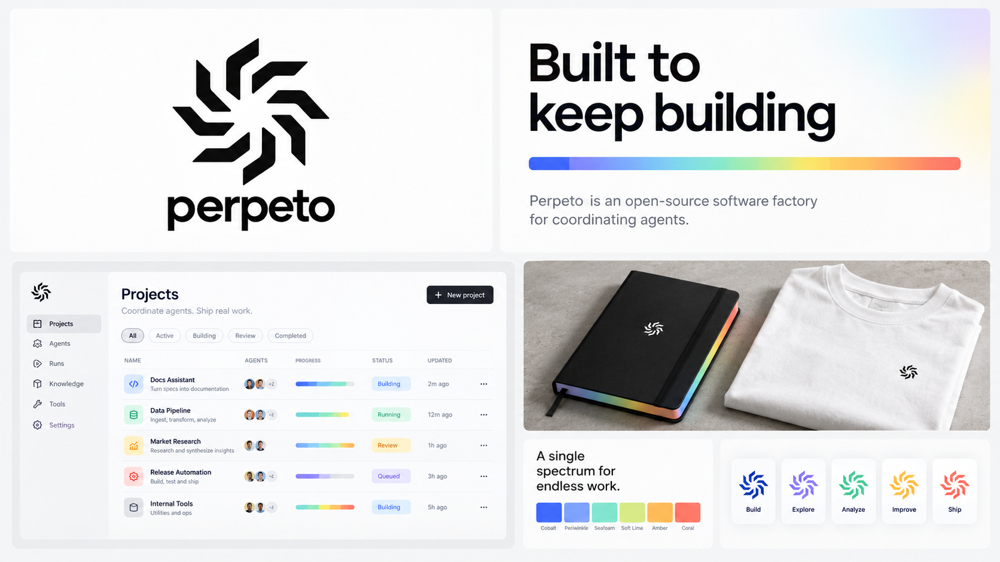
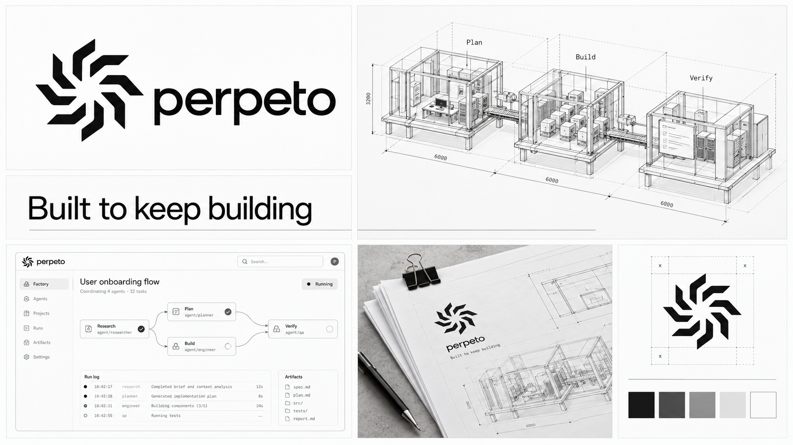

# Spectrum and architectural directions

Generated with the built-in image generation tool. Both are visual proposals retaining the Spindle logo and Built to keep building. The spectrum direction explores a coordinated full accent scale; the architectural direction uses strictly grayscale drafting and modular factory diagrams. Generated diagrams and UI are conceptual, not technical specifications. The master SVG remains the source for exact logo geometry.

## spectrum-system

### Generation prompt

Generate a sophisticated landscape 16:9 brand overview for Perpeto, an open-source software factory for coordinating agents. The supplied image is the selected Spindle logo: preserve its eight separate bent angular arms, original upright orientation and handedness. Keep lowercase name "perpeto" and exact slogan "Built to keep building". A cohesive high-end studio presentation in 5-6 asymmetric tiled panels with generous gutters and negative space: identity, typography, product interface, physical application, palette and visual language. Clean modern typography and restrained short legible text. No numbered eyebrow headings, no tiny indexed section kickers, no other brands or replacement logo. Product UI is a concept. The output is one finished brand presentation image, not a photo of an entire board. Direction: SPECTRUM SYSTEM. White, black and clean neutral grays establish the structure, but a coordinated range of colors is allowed. Use a full carefully curated accent scale: cobalt, periwinkle, seafoam, soft lime, warm amber and coral. Show these as an elegant continuous horizontal spectrum strip or aligned small swatches and consistent meaningful interface states, not as six unrelated themes. Let color occupy roughly 15-20% of the board, no rainbow confetti. Large identity tile black logo and black wordmark on near-white. Spacious slogan typography tile "Built to keep building" in confident neutral sans with a slender color spectrum underneath. Large beautifully crafted flat application window with quiet grayscale sidebar, sparse agent/project rows, colored status chips and discreet multicolor work streams. Photoreal matte black notebook with very small white logo and a subtle multicolor page-edge treatment, white heavyweight shirt folded beside it with tiny black chest mark. Another panel showing tasteful color-coded logo application labels on white cards, no excessive repetition. Clean editorial balance, geometric precision, minimal background texture, no dark gamer aesthetic. A unified functional color system with architectural discipline.

## architectural-monochrome

### Generation prompt

Generate a sophisticated landscape 16:9 brand overview for Perpeto, an open-source software factory for coordinating agents. The supplied image is the selected Spindle logo: preserve its eight separate bent angular arms, original upright orientation and handedness. Keep lowercase name "perpeto" and exact slogan "Built to keep building". A cohesive high-end studio presentation in 5-6 asymmetric tiled panels with generous gutters and negative space: identity, typography, product interface, physical application, palette and visual language. Clean modern typography and restrained short legible text. No numbered eyebrow headings, no tiny indexed section kickers, no other brands or replacement logo. Product UI is a concept. The output is one finished brand presentation image, not a photo of an entire board. Direction: MONOCHROME ARCHITECTURAL BLUEPRINT. Strict grayscale, graphite black ink, white drafting paper, soft concrete gray, absolutely NO blue cyan or colored accent. Sophisticated architectural practice meets precision machine engineering. Mix crisp thin technical drafting linework with generous blank space, restrained modern grotesk and functional monospaced annotations. Main identity tile: exact filled black Spindle logo alongside lowercase perpeto, quiet white field. Second large panel: an elegant plan/elevation/axonometric drawing of a modular software factory as a conceptual architectural system, thin consistent line weights, dashed hidden edges, structural modules labeled "Plan", "Build", "Verify", small believable dimensions only inside the drawing; no numbered titles or eyebrow headings. Slogan tile large "Built to keep building" with fine horizontal baseline, no decorative noise. Product UI panel resembling a precise architectural workbench: white background, black navigation, a fine-line task dependency diagram and a compact run log, clear enough to read as UI without excessive tiny text. Physical tile: photoreal stack of large white technical drawing sheets on a pale concrete desk with black binder clip and black pencil, small exact black Spindle stamped in corner. Small visual language tile: exact logo beside a very subtle construction guide demonstrating clearspace; do not turn the logo itself into a different shape. Palette consists white, paper gray, graphite, black. No distressed textures, no vintage blueprint aging, no colored blueprint background, no futuristic sci-fi, no decorative gear icons. Extremely clean and elegant technical drawing aesthetic, an actual convincing brand system.
