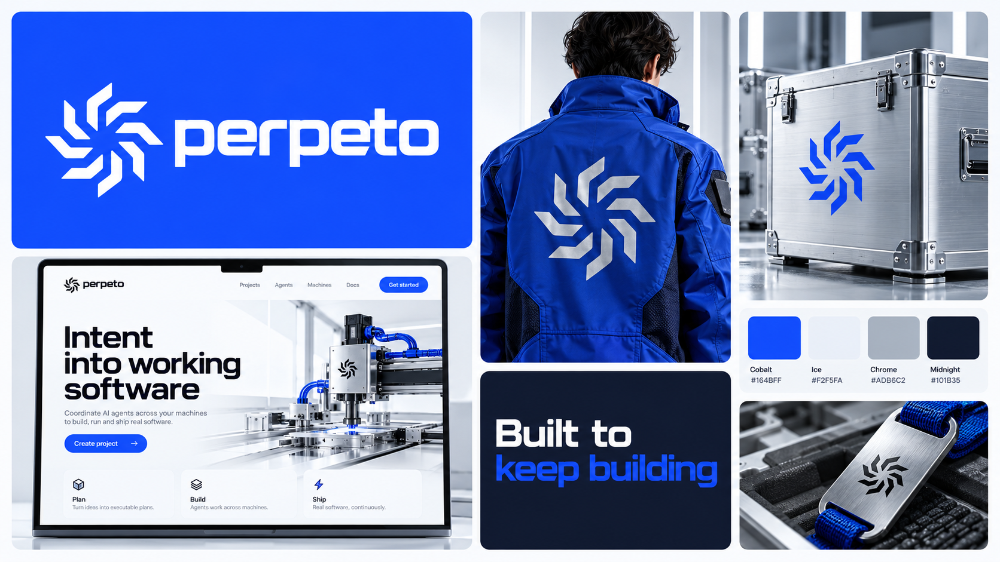
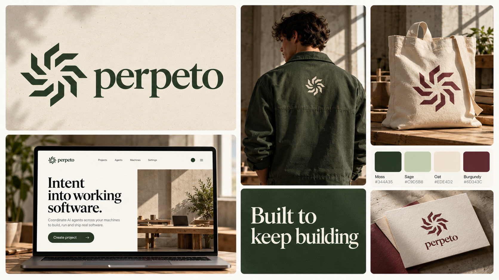
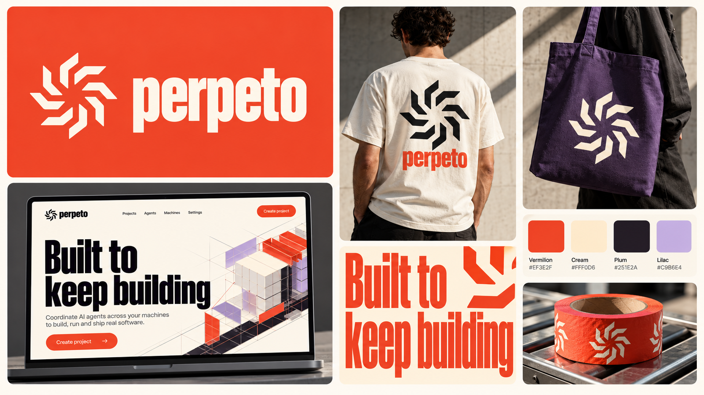
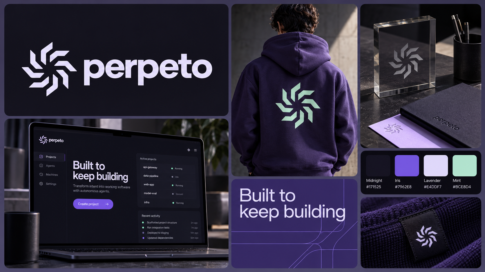
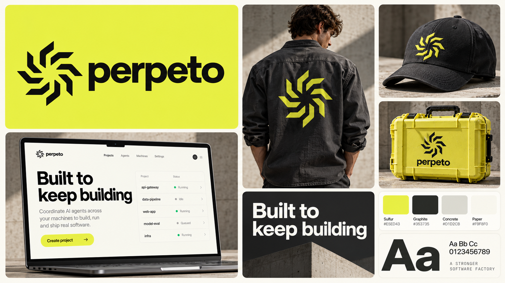

# Perpeto theme explorations

Five concept boards generated with the built-in image generation tool. The Spindle mark and “Built to keep building” are shared; palettes, type treatments, materials and mood vary. These are proposals, not approved replacements for the brand system. Generated logo details and swatch renderings are illustrative; use the source SVG and explicit palette values for production.

## cobalt-chrome

### Generation prompt

Create a high-end landscape 16:9 brand overview collage for an autonomous software factory. Use the supplied first image as LOGO reference: faithfully preserve the eight separate angular bent arms and original upright orientation of the Spindle mark. Second image is LAYOUT reference only: polished asymmetric bento tiles with rounded corners and generous gutters, a large identity tile, a website mockup, typography specimen and realistic merchandise. User prefers this arrangement. Make a completely new art direction, not a recolor. Only mandatory consistent elements are the exact Spindle logo and exact slogan "Built to keep building" (no final period). Wordmark may read "perpeto" with a unique type treatment appropriate to this theme. Keep text minimal and legible. Include a palette tile with 3-4 labeled color swatches, a striking slogan/type tile, one web or desktop UI mockup and 2 tactile real-world applications. No numbered eyebrows, no tiny numbered panel labels, no extra symbols replacing the logo, no infinity signs, no other company logos. This is one coherent premium studio brand presentation image, not a photograph of a moodboard. Each application must visibly belong to this exact theme.
Theme: PRECISION / COBALT CHROME. Cold, ultra-clean machine tooling with electric cobalt #164BFF, icy white #F2F5FA, brushed silver #ADB6C2 and deep navy #101B35. Wide extended geometric techno sans typography, squared custom-looking lowercase wordmark. Bright nearly shadowless studio photography. Materials: milled aluminum, satin cobalt nylon, polished reflective steel. Layout upper-left logo/wordmark on cobalt; lower-left large bright editorial website with precise structured grid; tall center photoreal cobalt technical jacket from back with silver logo; small center slogan typography panel; right brushed aluminum metal equipment case with blue screen-printed logo and palette tile. Sophisticated engineering, no cyberpunk or neon glow. Exact slogan "Built to keep building".

## moss-editorial

### Generation prompt

Create a high-end landscape 16:9 brand overview collage for an autonomous software factory. Use the supplied first image as LOGO reference: faithfully preserve the eight separate angular bent arms and original upright orientation of the Spindle mark. Second image is LAYOUT reference only: polished asymmetric bento tiles with rounded corners and generous gutters, a large identity tile, a website mockup, typography specimen and realistic merchandise. User prefers this arrangement. Make a completely new art direction, not a recolor. Only mandatory consistent elements are the exact Spindle logo and exact slogan "Built to keep building" (no final period). Wordmark may read "perpeto" with a unique type treatment appropriate to this theme. Keep text minimal and legible. Include a palette tile with 3-4 labeled color swatches, a striking slogan/type tile, one web or desktop UI mockup and 2 tactile real-world applications. No numbered eyebrows, no tiny numbered panel labels, no extra symbols replacing the logo, no infinity signs, no other company logos. This is one coherent premium studio brand presentation image, not a photograph of a moodboard. Each application must visibly belong to this exact theme.
Theme: FIELDWORK / BOTANICAL MODERNISM. Quiet intellectual open-source workshop with moss #344A35, pale sage #C9D5B8, oat #EDE4D2 and warm burgundy #6D343C. Elegant large contemporary serif typography paired with clean utilitarian sans, wordmark in a beautifully cut lowercase serif. Warm natural window light, recycled paper, sturdy canvas, ceramic. Upper-left large moss logo on oat identity tile; lower-left editorial website with generous whitespace and serif headline; tall middle tile person wearing moss chore jacket with small cream mark; right heavyweight oat canvas tote with burgundy logo and an elegant brand stationery closeup. Typography tile exact "Built to keep building". Palette tile. Feels architectural, humane, durable, grown-up; not eco cliches, no leaves or botanical illustrations.

## vermilion-bauhaus

### Generation prompt

Create a high-end landscape 16:9 brand overview collage for an autonomous software factory. Use the supplied first image as LOGO reference: faithfully preserve the eight separate angular bent arms and original upright orientation of the Spindle mark. Second image is LAYOUT reference only: polished asymmetric bento tiles with rounded corners and generous gutters, a large identity tile, a website mockup, typography specimen and realistic merchandise. User prefers this arrangement. Make a completely new art direction, not a recolor. Only mandatory consistent elements are the exact Spindle logo and exact slogan "Built to keep building" (no final period). Wordmark may read "perpeto" with a unique type treatment appropriate to this theme. Keep text minimal and legible. Include a palette tile with 3-4 labeled color swatches, a striking slogan/type tile, one web or desktop UI mockup and 2 tactile real-world applications. No numbered eyebrows, no tiny numbered panel labels, no extra symbols replacing the logo, no infinity signs, no other company logos. This is one coherent premium studio brand presentation image, not a photograph of a moodboard. Each application must visibly belong to this exact theme.
Theme: KINETIC / VERMILION MODERNISM. Bold Swiss/Bauhaus-inspired industrial publishing. Vermilion #EF3E2F, warm cream #FFF0D6, near-black plum #251E2A, muted lilac #C9B6E4. Strong tall condensed grotesk headlines, playful oversized cropping but very precise grid and big whitespace. Lowercase perpeto wordmark in black condensed sans. Upper-left large logo/wordmark cream on vermilion. Lower-left graphic website mockup with huge exact headline "Built to keep building", cream ground and vermilion action. Tall center photoreal cream tee on person, bold black Spindle and red wordmark. Right purple canvas tote with cream Spindle, large carefully composed typographic street poster and palette. Energetic confident editorial system, no random abstract decorations. Material details high-end and realistic.

## violet-night

### Generation prompt

Create a high-end landscape 16:9 brand overview collage for an autonomous software factory. Use the supplied first image as LOGO reference: faithfully preserve the eight separate angular bent arms and original upright orientation of the Spindle mark. Second image is LAYOUT reference only: polished asymmetric bento tiles with rounded corners and generous gutters, a large identity tile, a website mockup, typography specimen and realistic merchandise. User prefers this arrangement. Make a completely new art direction, not a recolor. Only mandatory consistent elements are the exact Spindle logo and exact slogan "Built to keep building" (no final period). Wordmark may read "perpeto" with a unique type treatment appropriate to this theme. Keep text minimal and legible. Include a palette tile with 3-4 labeled color swatches, a striking slogan/type tile, one web or desktop UI mockup and 2 tactile real-world applications. No numbered eyebrows, no tiny numbered panel labels, no extra symbols replacing the logo, no infinity signs, no other company logos. This is one coherent premium studio brand presentation image, not a photograph of a moodboard. Each application must visibly belong to this exact theme.
Theme: NOCTURNE / VIOLET SYSTEMS. Sophisticated dark digital luxury with midnight #171525, iris purple #7962E8, luminous pale lavender #E4DDF7 and pale mint #BCE8D4. Elegant refined thin-to-medium geometric sans headlines, gently tracked lowercase wordmark. Deep matte surfaces, translucent smoked acrylic, violet woven textiles, restrained edge lighting and tactile closeups; no glows or gradients as backgrounds. Upper-left logo in pale lavender against midnight. Lower-left refined dark desktop project interface mockup with generous negative space and exact headline "Built to keep building". Tall center violet heavyweight hoodie viewed from back with a small pale mint Spindle. Right smoked acrylic desk object with laser-etched logo, beautiful stationery set and palette. A quiet late-night engineering studio; avoid gamer aesthetics, space stars, chrome sci-fi.

## lemon-graphite

### Generation prompt

Create a high-end landscape 16:9 brand overview collage for an autonomous software factory. Use the supplied first image as LOGO reference: faithfully preserve the eight separate angular bent arms and original upright orientation of the Spindle mark. Second image is LAYOUT reference only: polished asymmetric bento tiles with rounded corners and generous gutters, a large identity tile, a website mockup, typography specimen and realistic merchandise. User prefers this arrangement. Make a completely new art direction, not a recolor. Only mandatory consistent elements are the exact Spindle logo and exact slogan "Built to keep building" (no final period). Wordmark may read "perpeto" with a unique type treatment appropriate to this theme. Keep text minimal and legible. Include a palette tile with 3-4 labeled color swatches, a striking slogan/type tile, one web or desktop UI mockup and 2 tactile real-world applications. No numbered eyebrows, no tiny numbered panel labels, no extra symbols replacing the logo, no infinity signs, no other company logos. This is one coherent premium studio brand presentation image, not a photograph of a moodboard. Each application must visibly belong to this exact theme.
Theme: UTILITY / LEMON GRAPHITE. Contemporary industrial workwear brand with sulfur yellow #E5ED43, graphite #353735, concrete #D1D2CB and paper #F9F8F0. Sturdy rounded utilitarian sans typography, robust lowercase perpeto wordmark, mono for small functional details only. Brutalist but friendly, large clean blocks, disciplined minimalism. Upper-left bold graphite Spindle and wordmark on sulfur. Lower-left utilitarian paper web interface mockup with strong black title exact "Built to keep building", short project table and yellow action. Tall center model in washed charcoal work shirt with sulfur logo. Right studio photo graphite cap with embroidered yellow Spindle and sulfur hard-shell tool case with black logo. A compact typography panel and palette panel complete the asymmetric tile layout. Natural concrete studio light, honest textile and molded polymer textures, no hazard stripes or warning symbols.
