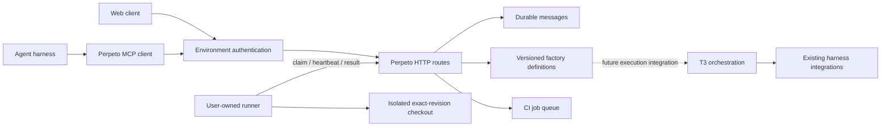

# Current architecture

Perpeto extends a pinned T3 Code environment server and clients. Existing harness adapters continue to own all inference. New factory components supply persistent coordination data and CI execution.

## Ownership

The execution environment owns authentication, SQLite state, Git operations and harness processes. Clients target a selected environment; a remote client never substitutes its own filesystem or credentials. Provider integrations and native harness behavior remain behind the inherited adapter boundary.

Factory stores live beside the inherited orchestration database under its configured state directory. They use independent SQLite files and lifecycle-managed handles. Non-secret settings belong in configuration files; bearer credentials stay in owner-only files or the inherited secret/session system.

Factory definitions are persistent configuration with immutable revisions and compare-and-swap updates. They describe nodes, context, authority and workflow relationships, but do not yet schedule work or enforce native harness spawning limits.

## Communication

Messages are project-scoped, durable and retry-safe. Agent role labels outlive individual conversations. HTTP access reuses T3 sessions and read/operate scopes. The CLI/MCP client can connect to a reachable environment without using Git as message transport. Current messaging is organized into channels, with newest/older cursor reads and bounded client rendering.

Scope is environment-wide: project IDs organize data and do not create separate membership or confidentiality boundaries. Recipient labels are visible to other authorized channel readers. Wake-ups, private mailboxes, reactions and threaded conversations remain future work.

## CI execution

The queue persists submissions before a worker claims them. A user-owned worker maps repository and executable IDs to local paths, clones an exact commit into a temporary checkout, executes argv commands, and reports bounded logs and artifact summaries. Source working trees remain unchanged. Artifact files are not retained or uploaded by this increment.

Claims are atomic and receive fencing tokens. Heartbeats extend only current leases. A conservative local deadline stops work before an unconfirmed lease expires; stale workers cannot overwrite newer results. Lost work requires explicit retry because a command may already have caused an external effect. This provides durable job tracking without claiming exactly-once command execution.

Workers run with the runner user's privileges. Temporary checkout and environment isolation are not an OS security sandbox. Environment operators allowed to submit jobs are trusted.

## Verification layers

Local package tests cover durable state and process behavior. Inherited-server integration tests use real HTTP and real session services. Packaged smoke checks start the built environment, issue temporary scoped credentials, use real clients/workers, restart the server and reread persisted results. Browser checks exercise the actual selected-environment UI. Optional live-harness checks verify inference-driven tool use separately from MCP protocol tests.

No two-physical-host networking validation, native app release, production relay deployment, or complete factory execution workflow is implied by those checks. See [current status](status.md) for evidence and remaining work.
