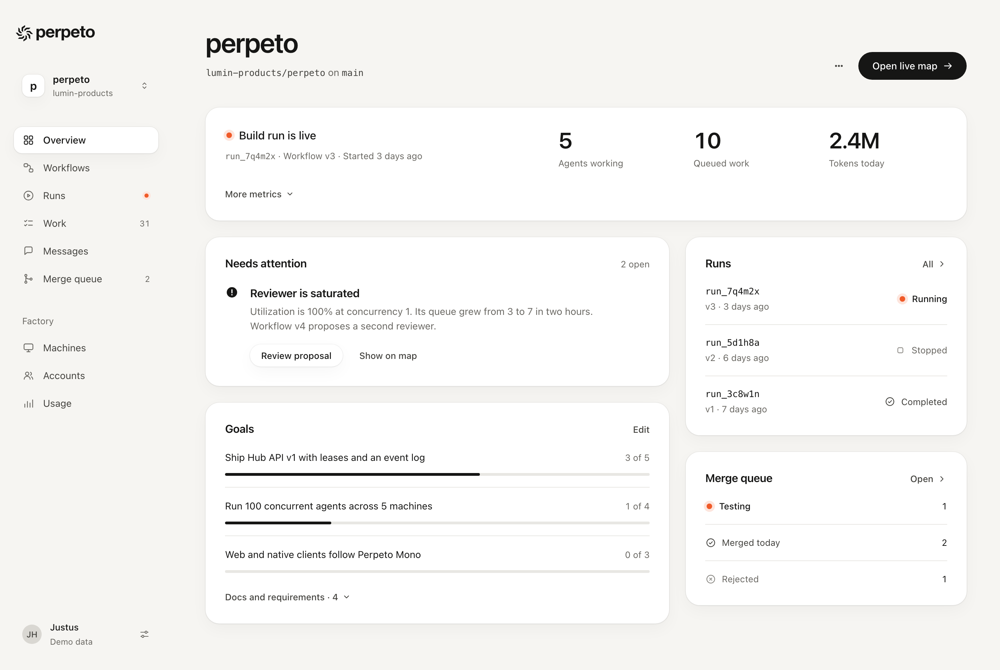
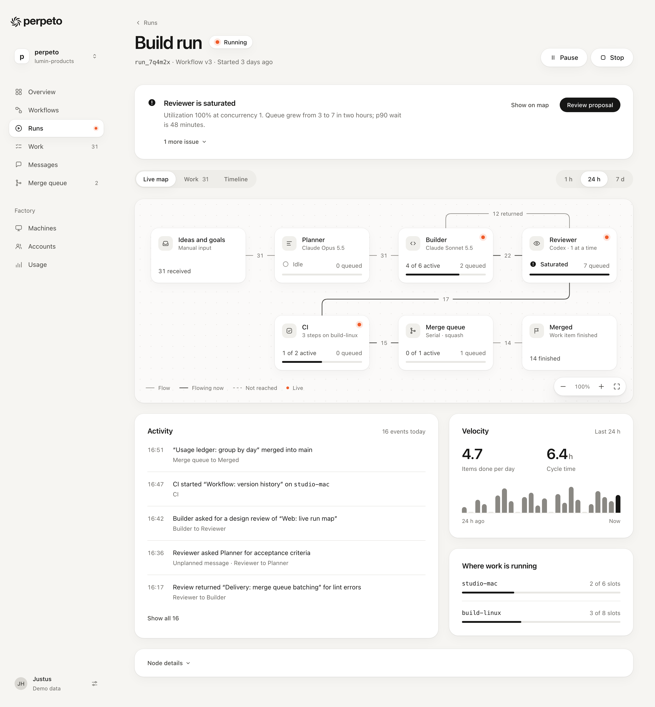

# Perpeto Mono design system

Status: selected. Justus chose Perpeto Mono as the product UI direction on 2026-10-21. It is specified here and in [`packages/design-tokens`](../../packages/design-tokens/README.md); the web and Apple clients have not been restyled yet. Values come only from the tokens, which are generated from [brand/tokens.css](../../brand/tokens.css). The [specimen](../../packages/design-tokens/specimen.html) renders every component below plus two mock screens; screenshots are in [packages/design-tokens/screenshots](../../packages/design-tokens/screenshots/).

Perpeto Mono in one line: warm paper canvas, white rounded cards, near-black ink, generous space, and one small orange dot for work happening right now.

## Principles

| Principle | In practice |
| --- | --- |
| Minimal | One primary action per view. Three numbers up front; the rest behind a disclosure. No decoration that doesn't carry information. |
| Spacious | 48 pt page padding, 28 pt card padding, 24 to 40 pt between blocks. Whitespace separates; rules are rare. |
| Monochrome | Greys and ink carry every state through icon, word and weight. Orange means live. Red means failed. Nothing else has a hue. |
| Rounded | Pill buttons and chips, 12 pt controls, 16 pt nodes, 20 pt cards, continuous corners on Apple. |
| Smooth | Short ease-out transitions on hover, press, disclosure and selection. Instant under reduced motion. |

## Using tokens

| Concern | Web | SwiftUI |
| --- | --- | --- |
| Colour | `var(--ink)`, `var(--surface-subtle)` | `PerpetoColor.ink`, `PerpetoColor.surfaceSubtle` |
| Spacing, 4 pt base | `var(--space-4)` (16) | `PerpetoSpacing.x(4)` |
| Layout | `var(--page-padding)`, `var(--card-padding)`, `var(--content-max)` | `PerpetoLayout.pagePadding`, `.cardPadding`, `.contentMax` |
| Radius | `var(--radius-control)` 12, `var(--radius-panel)` 20, `var(--radius-pill)` | `PerpetoRadius.control`, `.panel`, `Capsule()` |
| Elevation | `box-shadow: var(--shadow-card)` | `.perpetoCard()`, `.perpetoElevation(.raised)` |
| Interface type | `var(--text-14)` with `var(--leading-body)` | `PerpetoType.text(PerpetoType.text14)`, `.perpetoBody()` |
| Titles | `var(--display-40)`, `var(--weight-semibold)`, `var(--tracking-display)` | `.perpetoDisplay(PerpetoType.display40)`, `.perpetoTitle()` |
| Mono | `var(--font-mono)` | `PerpetoType.mono()` |
| Controls | `var(--control-height-md)` 40 | `PerpetoControl.height` |
| Live dot | `var(--accent)`, `var(--indicator-dot)`, halo `var(--accent-wash)` | `PerpetoColor.accent`, `PerpetoIndicator.dot` |
| Motion | `var(--duration-fast)`, `var(--ease-out)` | `PerpetoMotion.easeOut(reduceMotion:)` |

Never write a hex value, pixel size or font name in a client. If a value is missing, add it to `brand/tokens.css` (a decision) or `packages/design-tokens/src/scale.json` (a scale step or a mix of existing tokens), then regenerate.

## Colour

| Token | Value | Use |
| --- | --- | --- |
| `canvas` | warm off-white | The page, the sidebar, the app window background |
| `surface` | white | Cards, nodes, inputs, menus, the selected navigation item |
| `surface-subtle` | light warm grey | Icon tiles, selected rows, log blocks, disabled fills |
| `grey-100` to `grey-600` | warm greys | `border` (100), dot grid (200), quiet chart tracks (100), `faint` and `control-border` (400), `muted` (500), `ink-soft` (600) |
| `ink` | near-black | Titles, body text, primary buttons, focus ring, the strong chart bar |
| `accent` | signal orange | The live dot and the brand mark. Nothing else. |
| `error` | restrained red | Failed status and field errors only |

- Text is `ink`, `ink-soft` or `muted`. All three pass 4.5:1 on canvas, surface, `surface-subtle` and the hover fills; the build fails otherwise.
- `faint` and `control-border` are for icons and input boundaries at 3:1, never text.
- The accent is never a button, a link, a text colour, a fill larger than the dot, a border or a selection. A view with nothing live has no orange in it at all, apart from a brand moment.
- `success` and `warning` keep their names for compatibility but are greys now (`ink-soft` and `ink`). Status is told by icon, word and weight, not hue.
- Use red only where a failure would otherwise be missed: failed status, field validation, a failed check in a log. Never red buttons; destructive confirmations use the black primary with an explicit verb ("Stop run").
- Dark mode is still undefined. The Apple app keeps forcing light appearance.

## Typography

- System sans for everything; system mono only for identifiers: run IDs, repositories, branches, paths, commit hashes, machine names and model IDs. Timestamps, durations and counts use sans with tabular figures. Prefer display names ("Claude Opus 5.5") over model IDs in the UI.
- Three weights: regular for text, medium for labels and emphasis, semibold for titles and metrics.
- Interface sizes: 12, 13, 14, 16, 20, 24, 28, 32. Body 14 in the app and 16 for reading; meta 13 in `muted`; 12 only for captions, axis labels and edge counts.
- Page titles 40 semibold (32 on narrow screens), tracking −0.03em, line height 1.05. Card titles 16 semibold. Metrics 32 semibold with tabular figures; 20 when secondary.
- Display 48 to 72 is for brand and empty landing moments, not product views.
- Sentence case everywhere: titles, buttons, table headers, navigation, group labels. Titles stand on their own: no numbered or indexed labels, no eyebrows, no tracked-out or uppercase kickers, no uppercase table headers.

## Layout

- **Content width.** Main content caps at `content-max` (1120) and centres in the space beside the sidebar. Reading text caps at `reading-max` (680).
- **Whitespace.** Page padding 48 (24 below about 720 pt), card padding 28 (20 compact), 24 between cards, 40 between page sections. Reserve space for anything that updates so controls never shift.
- **Separation.** Cards sit on the canvas with `shadow-card`. Don't box things inside cards: group with space, and use a hairline (`border`) only between list rows. No panels inside panels.
- **One primary action per view.** The black pill is the main next step: "Open live map", "Review proposal", "Create project". Everything else is secondary (white pill) or ghost. If two actions compete, one of them belongs in a menu.
- **Progressive disclosure.** Show the answer first: the live state, what needs a person, and at most three numbers. Secondary metrics, node tables, older events, docs lists and second issues sit behind a disclosure ("More metrics", "Node details", "Show all 16", "1 more issue") or on their own page.
- **Order.** Page header, then what is live, then what needs attention, then the work itself, then history.
- **Narrow screens.** One column. The primary action goes full width under the title. Tables become stacked lists or scroll inside their card; the workflow map becomes a step list. Nothing is compressed until it's illegible.

## Shape, depth and motion

- Radii: `radius-small` 8 (tiny chips, log lines), `radius-control` 12 (inputs, menus, icon tiles, nav items, table row highlights), `radius-node` 16 (map nodes, compact cards), `radius-panel` 20 (cards), `radius-sheet` 28 (sheets, dialogs, mobile frames), `radius-pill` for buttons, chips, segmented controls and meters. Apple uses `.continuous` corners.
- Elevation, all soft: `shadow-card` for resting cards, nodes, secondary buttons and the current nav item; `shadow-raised` for hover, the map toolbar and selected nodes; `shadow-overlay` for menus, popovers, sheets, the mobile tab bar and a node being dragged. Each includes a faint ring, so no border is needed.
- Motion: `duration-fast` 140 ms with `ease-standard` for hover and press; `duration-base` 220 ms with `ease-out` for disclosure, segmented thumbs, toggles and selection; `duration-slow` 360 ms for sheets. Press scales primary and secondary buttons to 0.98. Under reduced motion every duration is 0 and Apple animations are `nil`. No looping animation in rows; the Spindle loader from `brand/motion/selected/` stays the only page-level loader.

## Components

### App shell

- **Web**: a two-column grid, `sidebar-width` (248) sidebar and the main column, both on `canvas`. No header bar and no divider between them; whitespace does it. Below 720 pt the sidebar is replaced by a top bar (Spindle and a menu button) and a floating tab bar.
- **Apple**: `NavigationSplitView`. Hide the sidebar list's material and scroll background so it shows `canvas`. Keep the toolbar minimal and untitled; the page title lives in the content. iOS uses the system `TabView` with Overview, Runs, Work, Messages and More, which the web's floating tab bar mirrors.

### Sidebar

- From top: the lockup (ink, about 22 pt of glyph height), the project switcher, project navigation, then the Factory group, then the account row pinned to the bottom.
- Project switcher: a 32 pt white monogram tile with `shadow-card`, the project name in semibold, the owner in 12 `muted`, and an up-down chevron. Don't repeat the Spindle here.
- Items: 38 tall, `radius-control`, 18 pt outline icon in `muted`, label in `ink-soft`. Hover `canvas-strong`. Current: `surface` with `shadow-card`, `ink` label in medium, `ink` icon. Counts in 12 `muted` tabular, right-aligned. A run in progress shows the live dot instead of a count.
- Group label: "Factory" in 13 `muted`, sentence case, 24 pt above it.

### Page header

- Optional back link ("‹ Runs") in 13 `muted`, then the title (40 semibold) with an inline status chip when the object is live, then one meta line in 14 `muted` with identifiers in mono.
- Actions align to the bottom right: at most one primary, plus secondary pills or an icon button for the overflow menu. On narrow screens actions go full width under the meta line, 48 tall.

### Cards

- `surface`, `radius-panel`, `shadow-card`, `card-padding`. No border.
- Head: title in 16 semibold on the left; one quiet item on the right, either a 13 `muted` meta ("Last 24 h", "2 open") or a 13 medium link with a chevron ("All runs ›"). 20 pt below the head.
- A card holds one idea. If it needs a second title, it's a second card.

### Lists and tables

- Lists: rows of 16 pt vertical padding separated by a `border` hairline, no hairline above the first row or below the last. Optional 36 pt icon tile (`surface-subtle`, `radius-control`). Title in 14 medium, meta in 13 `muted`, status or value at the end.
- Tables: header cells in 13 regular `muted`, sentence case, with no rule under the header beyond the first row's hairline. Row hairlines in `border`, no zebra stripes, no vertical rules. Cells 16 pt padding; numbers right-aligned and tabular. Hover is `surface-hover` and selection `surface-subtle`, drawn as a 12 pt rounded row inset from the card edge, with the hairlines either side hidden.
- Long or wide tables: show the columns that answer the question and put the rest in a disclosure or detail view. On narrow screens, scroll horizontally inside the card or switch to a stacked list.

### Buttons

| Kind | Fill | Text | Use |
| --- | --- | --- | --- |
| Primary | `action` (ink), hover `action-hover`, pressed `action-pressed` | `on-action` | One per view |
| Secondary | `surface` with `shadow-card`, hover `surface-hover` with `shadow-raised` | `ink` | Other actions, toolbar actions on canvas |
| Ghost | transparent, hover `canvas-strong` | `ink-soft`, hover `ink` | Cancel, "Show on map", row and card actions |
| Disabled | `surface-subtle`, no shadow | `muted` | Explain why nearby when it isn't obvious |

- All buttons are pills. Heights 32 (small: rows, cards, toolbars), 40 (default), 48 (large: narrow-screen primaries, empty states). Padding 16, 20, 24. Labels 13, 14, 16 medium.
- Labels are verbs in sentence case. Icons are optional, 18 pt, leading; trailing only for an arrow that opens something ("Open live map →").
- Icon-only buttons are circles at the control height with an accessible label.
- There is no danger style. Destructive actions ("Stop") are secondary and always confirm in a sheet whose primary says exactly what happens.

### Inputs

- 40 tall (48 on touch), `surface`, 1 pt `control-border` (3:1), `radius-control`, 16 pt padding, 14 text. Mono 13 for paths, branches, URLs and identifiers.
- Label above in 13 medium, help below in 13 `muted`. Placeholder is an example, never the label.
- Hover darkens the border to `ink-soft`. Focus turns it `ink` with a matching 1 pt inner ring, so the field reads as 2 pt.
- Error: border becomes `error`, and a 13 pt message with the failed icon says what's wrong and how to fix it, linked with `aria-describedby`.
- Search is the exception: a pill on `surface` with `shadow-card` and a leading search icon, no border.
- Toggles: 40 by 24 pill track, `grey-300` off and `ink` on, white thumb that slides with `ease-out`.

### Segmented controls

- A pill track in `canvas-strong` with 3 pt inset. Options are 34 tall, 13 medium `muted`. The selected option is a white pill with `shadow-card` in `ink`; the thumb change animates with `duration-base`.
- Use for switching views of the same object (Live map, Work, Timeline) and time windows (1 h, 24 h, 7 d). Counts inside options are regular weight.

### Status

| Status | Icon | Text | Means |
| --- | --- | --- | --- |
| Running, testing | Orange live dot with a soft halo | `ink`, medium | Work is happening now |
| Saturated, attention | Filled ink circle with a mark | `ink`, medium | A person should look |
| Approval needed | Filled ink triangle with a mark | `ink`, medium | A person must decide |
| Blocked | Outline circle with a bar | `ink-soft` | Waiting on another item |
| Queued, idle, not reached | Outline circle in `faint` | `muted` | Accepted, not started |
| Paused, stopped | Outline pause or square in `faint` | `muted` | Stopped by a person |
| Verified, completed, merged | Outline circle with a check | `ink-soft` | Only when named checks passed |
| Failed | Outline circle with a cross in `error` | `error`, medium | Name the operation and the recovery |

- Every status is an icon plus a word. Inline form: 16 pt icon, 8 pt gap, 13 text. Chip form, for headers: a 28 pt pill on `surface` with `shadow-card`; quiet chips (`surface-subtle`, no shadow, regular weight) for versions and counts.
- Weight carries urgency: things that need a person are medium and filled; things that are fine are regular and outlined.
- The live dot is static in rows and nodes. "Verified" means checks passed, not that an agent finished its turn.

### Metrics and charts

- Three metrics at most in a row: value in 32 semibold tabular, label beneath in 13 `muted`. Units in 16 medium `muted` after the value ("6.4 h").
- Bars: `chart` (`grey-400`) with pill tops and 4 pt gaps; the current period in `chart-strong` (ink); empty periods as 2 pt `chart-quiet` stubs. One baseline hairline, labels only at the ends ("24 h ago", "Now"). No gridlines, no legends for a single series, no orange.
- Progress meters: 4 pt pill, `chart-quiet` track, `ink` fill, count beside it in 13 `muted` ("3 of 5").
- Several series: separate them by grey value (`ink`, `grey-400`, `grey-200`) and label the lines directly. If they still can't be told apart, show fewer series.

### Progressive disclosure

- A disclosure is a ghost text button in 13 medium `ink-soft` with a trailing chevron that turns 180° when open. Content expands with `duration-base` and `ease-out` (web: `details::details-content` with `interpolate-size`; Apple: `DisclosureGroup` with `PerpetoMotion.easeOut`).
- Name what is hidden and how much: "More metrics", "Node details", "Docs and requirements · 4", "Show all 16", "1 more issue".

### Empty and error states

- Empty: centred in its card with 48 pt of space around. A 48 pt `surface-subtle` icon tile, a 20 semibold title ("No workflows yet"), one sentence in `muted`, one large primary. No illustrations, no oversized logo.
- Error: the failed icon and the affected operation as the title ("Build failed"), one or two sentences on what happened, the relevant log lines in mono 12 on `surface-subtle` with `radius-control`, then the recovery action as the primary and "Open full log" as ghost. `role="alert"` on web.
- Interruptions say what's saved: "Worker disconnected. Its last reported progress is saved."

### Workflow map

The map should read as a calm drawing: soft cards on a quiet field joined by thin lines.

- **Canvas**: a card in `editor-canvas` (a touch lighter than the page) with `radius-panel` and `shadow-card`. A dot grid every 24 pt (`editor-dot-spacing`) in `editor-dot`, 1.5 pt dots. No line grid. It pans; nodes never scale down to fit a narrow screen.
- **Nodes**: 208 wide (`editor-node-width`), 120 tall, `surface`, `radius-node`, `shadow-card`, 16 pt padding. A 32 pt icon tile, the name in 14 medium, one line of meta in 12 `muted`, then at the bottom one stat line in 13 tabular and a 4 pt meter. Gaps of 64 horizontally and 72 vertically (`editor-node-gap-x/y`). Hover lifts to `shadow-raised`.
- **Live**: the orange dot sits in the node's top-right corner, 16 pt in, only while the step has active work. Don't tint, outline or animate the node.
- **Attention**: the stat line shows the attention status ("Saturated") and the meter fills in ink. The node itself stays white.
- **Selection**: a 1.5 pt `ink` ring (`stroke-selection`) plus `shadow-raised`. Multi-select uses the same.
- **Focus**: the 2 pt `focus` outline with a 2 pt offset, separate from selection, so a focused node can also be selected. Every node, port and edge is reachable by keyboard.
- **Dragging**: `shadow-overlay` and a 2 pt lift.
- **Edges**: 1.25 pt `editor-edge` (`grey-400`, 3:1), orthogonal, with 12 pt rounded corners (`editor-edge-corner`). Edges that carried work in the selected window are 1.5 pt `editor-edge-active`. Paths not reached yet are dashed 3/5. No arrowheads, glows or animated dashes; flow runs left to right and top to bottom, and loops leave from the top of a node and return to the top of the earlier one.
- **Edge labels**: counts in 12 `muted` tabular inside a 20 pt pill filled with `editor-canvas`, centred on the edge, so the line seems to pass behind them. Name returns in words ("12 returned").
- **Ports**: editor only, hidden on the live map. 8 pt circles on the node edge, a 1.5 pt `editor-edge` ring when open, solid `editor-edge-active` when connected. A valid drop target while dragging gets the `ink` ring.
- **Toolbar**: a pill in `surface` with `shadow-raised`, bottom right: zoom out, the zoom level in 12 `muted`, zoom in, fit. Ghost icon buttons, 32 pt.
- **Legend**: bottom left in 12 `muted`, only the styles currently on screen: Flow, Flowing now, Not reached, Live.
- **Narrow screens**: replace the map with a vertical step list in flow order. Each step is a compact card (icon tile, name, one line of meta, a status or count at the end) joined by a short grey connector. Returns are written in the meta ("12 returned to Builder").

### Marks in the product

- The lockup and symbol come from `packages/design-tokens/assets`, never redrawn. In the product they are `ink` on canvas. Orange is for display-size brand moments only.
- Keep clearspace of one arm width on every side. Don't rotate, outline, add effects or animate the static mark outside the selected motion studies.
- Below 24 pt the master Spindle muddies. A simplified small variant is proposed but not approved; see [assets/README.md](../../packages/design-tokens/assets/README.md).

## Accessibility

- Text pairs meet WCAG AA at 4.5:1; icons, input borders, the live dot, edges and chart bars meet 3:1. The pairs and ratios are in `dist/tokens.json` and the specimen, and the build fails below them.
- Never rely on colour: every status has an icon and a word, every chart series is labelled, the live dot has an accessible label ("Live").
- Visible focus on every interactive element: 2 pt `focus` outline with a 2 pt offset. Never remove it.
- Touch targets are at least 44 pt on iOS and narrow web.
- Respect reduced motion on both clients (see Motion).

## Do

- Use paper for the page and white cards for work.
- Give every view one black primary action.
- Separate with whitespace and surface contrast before reaching for a rule.
- Show three numbers and disclose the rest.
- Pair every status with an icon and a word; use weight for urgency.
- Keep titles big, short and in sentence case.
- Keep columns stable and numbers tabular.
- Put events and logs next to the work they explain, latest few first.

## Don't

- Orange buttons, links, text, fills, borders or selection.
- Red for anything except failure; status colours in green or amber.
- Boxes inside boxes, heavy rules, zebra rows or vertical table rules.
- Uppercase headers, numbered eyebrows, indexed labels or tracked-out kickers.
- Line grids, glows, gradients, glass, decorative shadows or animated dashes.
- Mono for anything that isn't an identifier.
- Dashboards of decorative metrics, or more than three headline numbers in a row.
- Spinners or pulsing in rows, or "verified" for work no named check confirmed.
- Ad-hoc colours, sizes or fonts outside the tokens.

## Legacy aliases

These names stay only so the current clients keep building until the restyle lands. Remove them from `src/scale.json` afterwards.

| Name | Now resolves to | Replace with |
| --- | --- | --- |
| `success-wash`, `warning-wash` | `surface-subtle` | `surface-subtle`, or nothing: status chips no longer have tinted fills |
| `grid-minor`, `grid-major` | `editor-dot` | `editor-dot` with the dot grid |
| `PerpetoEditor.gridMinor`, `.gridMajor` (Swift) | 16 and 64, unchanged | `PerpetoEditor.dotSpacing` |

`success` and `warning` are not legacy: they are the status roles, now grey.
