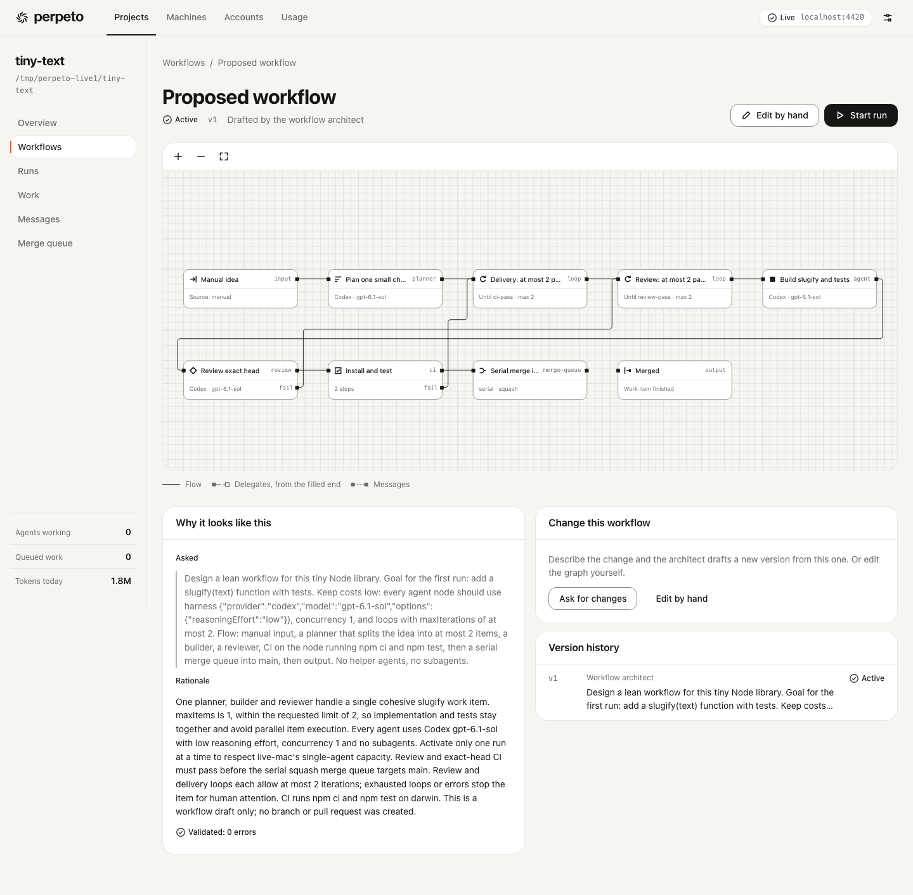
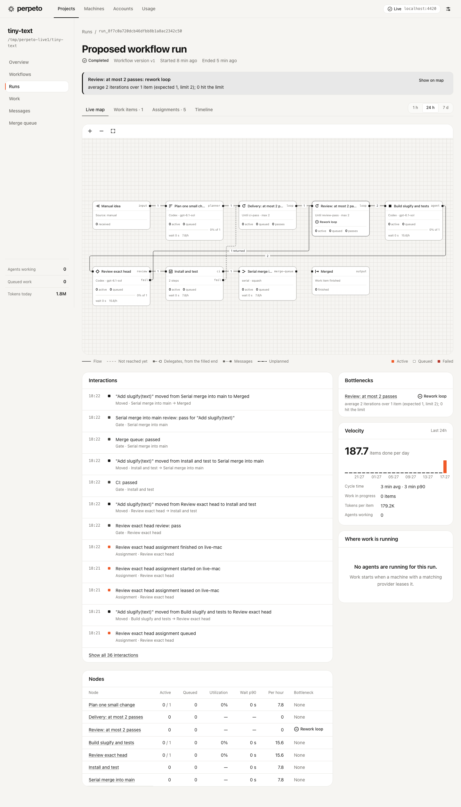

# Live acceptance run 1

21 October 2026, branch `t3/d3d91fb8` from main `1986ea7`. Not pushed or merged.

**Result: a real factory run merged working code.** On one Mac, a hub, one node and the vendored T3 runtime took "Add a `slugify(text)` function with tests" from a workflow drafted by the architect, through a planner, a builder, a failing review, a rework, a passing review, CI on the node and a serial merge queue into the bare repository's `main`. Every agent turn was a real Codex turn through T3. The first run failed at the merge step; that bug and three others are fixed in separate commits below.

| | Result |
| --- | --- |
| Harness turns | 9 of the 15 allowed: architect 1, run 1 3, run 2 5. All Codex `gpt-6.1-sol`, `reasoningEffort: low` |
| Tokens (`/usage`) | 293,424 uncached input, 10,971 output, 1,536,512 cache read, 0 cache write. `costUsd` 0 (subscription) |
| Agent time | First turn 05:15:05Z, last 05:22:25Z: about 7 minutes |
| Run 1 | Failed at merge, `missing_pull_request`, after review and CI passed (1 min 54 s) |
| Run 2 | Completed and merged in 2 min 53 s |
| Merged code | `main` at `76e2a09`, fresh clone: `npm ci` and `npm test` pass, 6 of 6 tests |

## Setup

Everything lived under `/tmp/perpeto-live1`. `~/.perpeto`, the normal T3 state and the account pool were untouched; no logins were created, switched or imported. The harnesses used this Mac's existing Codex (ChatGPT Pro) and Claude Max logins, which T3 reported `ready`.

```sh
source ~/.nvm/nvm.sh && nvm use 24          # Node v24.22.0
npm run setup && npm run build              # 22 s, pnpm store already warm
R=/tmp/perpeto-live1

# T3 runtime on a spare port with its own base directory
node vendor/t3code/apps/server/dist/bin.mjs serve --base-dir $R/t3 --host 127.0.0.1 \
  --port 4410 --no-browser --auto-bootstrap-project-from-cwd=false

# Hub and node through the CLI (the --dir must already be mode 700 if it exists)
chmod 700 $R/cli
node apps/cli/bin/perpeto.js --dir $R/cli hub init --port 4420
#   hub.json edits while stopped: corsOrigins ["http://localhost:5190"],
#   architectHarness {"provider":"codex","model":"gpt-6.1-sol","options":{"reasoningEffort":"low"}}
node apps/cli/bin/perpeto.js --dir $R/cli hub start
node apps/cli/bin/perpeto.js --dir $R/cli hub enroll-code
node apps/cli/bin/perpeto.js --dir $R/cli node join http://127.0.0.1:4420 --code-file $R/cli/enr_….secret --name live-mac
#   node.json edits: runtime.url "http://127.0.0.1:4410", runtime.t3 {"baseDir": "/tmp/perpeto-live1/t3"},
#   providers ["codex","claudeAgent"]
node apps/cli/bin/perpeto.js --dir $R/cli node start
```

The node used the default `executorPackages: ["@perpeto/t3-executor"]`, which resolved through the npm workspaces, and minted its T3 session with T3's own CLI against `$R/t3`. Capacity was one agent and one CI job.

The throwaway project was `tiny-text`: `package.json` with `"test": "node --test"`, an empty-dependency `package-lock.json`, `src/index.js` exporting `capitalize`, and one test. It was committed in `$R/seed` and cloned bare to `$R/tiny-text.git` (`d111e18`). Owner API calls went through a small script that reads `owner.secret` from file and never prints it.

```text
POST /projects                     {name, repo:{url, localPath: $R/tiny-text.git, defaultBranch: main}, goals}
POST /projects/:id/workflows/drafts {prompt: lean workflow, Codex gpt-6.1-sol low, concurrency 1, loops ≤ 2,
                                     planner ≤ 2 items, builder, reviewer, CI npm ci + npm test, serial merge}
POST /workflows/:id/activate       {version: 1}
POST /workflows/:id/runs           {}            then POST /runs/:id/inputs {items:[{title, body}]}   (run 1)
POST /workflows/:id/runs           {input:{items:[…]}}                                                (run 2)
```

## The architect's workflow

The architect turn took about 50 s and produced a valid graph on the first attempt: input, planner (`maxItems: 1`), delivery loop (`ci-pass`, max 2), review loop (`review-pass`, max 2), builder, reviewer, CI (`npm ci`, `npm test`, darwin), serial squash merge queue with `requiredChecks: ["ci"]`, output. Every agent node used the requested harness, concurrency 1 and `maxSubagents: 0`. I activated it unedited, so the architect itself was tested. Two weaknesses are recorded as findings: every node has `retry.maxAttempts: 1`, and the builder prompt says to open a pull request although the repository is a local bare one.



## Run 1: failed at the merge queue

| Time (UTC) | Step | Outcome |
| --- | --- | --- |
| 05:16:17 to 05:16:40 | Planner | `items: []` (already one PR) |
| 05:16:40 to 05:17:39 | Builder | Committed `c80c7c4`, branch published, no PR URL |
| 05:17:39 to 05:18:08 | Reviewer | `pass` |
| 05:18:08 | CI on live-mac | Both steps passed at `c80c7c4` |
| 05:18:08 | Merge queue | Item failed: `missing_pull_request`. Run `failed` |

Tokens: 95,243 uncached input, 3,613 output, 619,904 cache read.

**Root cause:** the workflow engine sends an item to a merge-queue node only with `prUrl` and `headSha`. Local delivery addresses branches as `local:<branch>`, the e2e fake executor invented that value, and the real T3 executor reported only URLs the agent mentioned. A builder working against a local bare repo can never mention one. Fixed in `560b642`.

## Run 2: merged

| Time (UTC) | Step | Outcome |
| --- | --- | --- |
| 05:19:33 to 05:20:01 | Planner | `items: []` |
| 05:20:01 to 05:21:00 | Builder | `e4f2c1d`, reported `prUrl: local:perpeto/wi_8f7c…_1` |
| 05:21:00 to 05:21:27 | Reviewer | **`fail`**: lowercasing ran before filtering, so the Kelvin sign `K` became ASCII `k` instead of a separator. A real bug |
| 05:21:27 to 05:21:59 | Builder (rework) | `748aa97`, fixed ordering, added `K` and `İ` regressions |
| 05:21:59 to 05:22:25 | Reviewer | `pass` |
| 05:22:25 | CI on live-mac, from a hub bundle | `npm ci`, `npm test` passed at `748aa97` |
| 05:22:25 to 05:22:26 | Merge queue | Speculative job passed on candidate `76e2a09`, published to `main` |

Tokens: 174,157 uncached input, 5,063 output, 849,408 cache read; the run reports 179,220 input and output tokens per item (planner 37,399, builder 62,346 over two turns, reviewer 79,475 over two). The hub recorded 5 `gate.result`, 11 `workitem.moved`, 3 `loop.iteration` and 3 `merge-entry.updated` events for the run. Event lines are in [run1-events.txt](live-acceptance-1/run1-events.txt) and [run2-events.txt](live-acceptance-1/run2-events.txt).



### Final Git state of `tiny-text.git`

```text
refs/heads/main                                     76e2a09  Perpeto merge mq_8f7c0a720dcb46dfbb8b1a8ac2342c50_1
refs/heads/perpeto/wi_8f7c0a720dcb46dfbb8b1a8ac2342c50_1  748aa97  Fix Unicode separator handling in slugify
refs/heads/perpeto/wi_a37a00d1f60d4294a1ad3e85fe40cbbe_1  c80c7c4  (run 1, never merged)
refs/perpeto/candidates/c84e9164…                    76e2a09
```

`main` is one squash commit on `d111e18`. It adds `slugify` (strings only, ASCII `a-z0-9` runs kept, everything else a single hyphen, edges trimmed) to `src/index.js`, a README note and `test/slugify.test.js`. Spot checks: `"Hello, world!"` → `hello-world`, `"a---__b"` → `a-b`, `""` → `""`, and `"Crème brûlée"` → `cr-me-br-l-e`. The last matches the planner's stated contract; whether accented letters should transliterate is a product question no reviewer raised. Run branches are not deleted after merge.

## Web app against the live hub

`npm run dev -w @perpeto/web -- --port 5190` (port 5180 was taken by another session's server), then Playwright through the Settings form with hub URL `http://localhost:4420`. Pages render real data: workflow, both runs with interactions, bottleneck and velocity, merge queue with `local:…` entry and speculative job, machines, usage.

| Screen | File |
| --- | --- |
| Project overview | [overview.png](live-acceptance-1/overview.png) |
| Workflow drafted by the architect | [workflow.png](live-acceptance-1/workflow.png) |
| Merged run | [run-merged.png](live-acceptance-1/run-merged.png) |
| Failed run | [run-failed.png](live-acceptance-1/run-failed.png) |
| Work (empty: nothing running) | [work.png](live-acceptance-1/work.png) |
| Merge queue | [merge-queue.png](live-acceptance-1/merge-queue.png) |
| Machines | [machines.png](live-acceptance-1/machines.png) |
| Usage | [usage.png](live-acceptance-1/usage.png) |

The first attempt used `http://127.0.0.1:4420` as the README suggests: `POST /session` returned 201, the next `GET /session` 401, and the app quietly showed its demo factory instead. Cause and fix below.

## Fixed during the run

| Commit | Problem | Fix and evidence |
| --- | --- | --- |
| `560b642` | Real builders on a local bare repo report no `prUrl`, so every item fails at the merge queue (run 1) | Executor reports `local:<branch>` after publishing to a local, non-GitHub origin when the agent named no PR. Two tests; run 2 merged with it |
| `a1413fd` | Node provider discovery scans only the daemon's PATH. Under nvm, Node 24's PATH hides the `codex` CLI installed with Node 22, so the node advertised only `claudeAgent` while T3 had Codex ready | Executors may report `providers()`; the T3 executor returns T3's enabled, ready drivers, bounded by a 10 s startup wait and the `providers` setting. Two tests; live, with `codex` absent from PATH the node advertised `["claudeAgent","codex"]` |
| `a641e97` | `perpeto node stop` reported stopped but the process lived on: shutdown never closed executors, and the T3 executor's WebSocket kept it alive. Two such daemons were found running | Node shutdown calls each executor's `close()`. One test; live, a stopped node exited, and both pre-fix leftovers were killed |
| `2ba1c61` | Project overview labelled `tokensToday` "input and output" although the hub includes cache (1.8M there, 304K on Usage). Web README paired a `localhost` app with a `127.0.0.1` hub, which breaks the `SameSite=Strict` cookie | Label now says cache is included; README explains same-host addressing |

Run 1 used the workaround of appending the Node 22 bin directory to the node daemon's PATH; run 2 used that PATH plus the `prUrl` fix. The discovery and shutdown fixes were verified live after run 2.

Checks after the fixes: `npm test -w @perpeto/t3-executor` 35 of 35, `npm test -w @perpeto/node` 68 of 68, `npm test -w @perpeto/cli` 21 of 21, `npm test -w @perpeto/web` 27 of 27. The repository-wide `npm test` was not run.

## Open findings

1. **Planner refinements are lost when it keeps one item.** With `items: []` the engine moves the original input on unchanged. The planner's contract and acceptance examples never reach the builder, whose architect-written prompt refers to "the agreed contract". The builder happened to infer the same contract. The engine should carry the planner's notes onto the item (`packages/workflow/src/engine.js`, `planned`).
2. **Workers inherit the operator's personal setup.** Planner and builder turns said they were "using the messaging skill" from the operator's global instructions, and agent commits were authored with the operator's global Git identity. Factory threads need a defined instruction and identity boundary, probably per account home.
3. **T3's own orchestration guidance leaks into factory threads.** The rework builder tried to register `local:…` as a pull request through a T3 tool and reported that T3 rejected it. Harmless here, but it spends turns and could act on T3 state.
4. **Token cost per turn is high for the task.** About 32,000 uncached input tokens per turn at low effort, 179,000 tokens per item for a six-line function. Most is likely T3's system prompt, tool definitions and the inherited instructions; this was not broken down.
5. **The architect's defaults are fragile for this setup.** `retry.maxAttempts: 1` on every node means one transient harness or Git error fails the item. Its builder prompt asks for a pull request even though the prompt it received named a local bare repository. The architect prompt should say how local repositories are delivered.
6. **Run metrics report zero for input, output and loop nodes.** `GET /runs/:id/metrics` gives `done: 0` for them, so the map shows "0 received" and "0 finished" for a run that shipped its item. Velocity extrapolates one item in three minutes to 187.7 per day.
7. **Two "Tokens today" figures disagree by design.** `/overview` counts cache, Usage does not. The label is fixed; whether both should use one definition is a contract decision.
8. **A failed session silently becomes demo data.** After the cookie was rejected, pages showed the built-in demo factory (machines `studio-mac`, `build-linux`) with only a Settings notice. An operator could mistake it for their factory.
9. **Small CLI notes.** `hub init --dir` refuses an existing directory that is not mode 700, with a clear message. `hub stop` on an idle hub answers "Active work is draining".

## Not verified

Claude harness turns (Claude was ready and advertised, but the workflow used Codex only), subscription account pools, more than one node or machine, GitHub delivery, the `triage` and senior-review escalation paths, cancellation of live turns, and hub or node restarts during a live turn. The hub restart for screenshots happened after both runs ended.

## Cleanup

T3, hub, node and the web dev server were stopped; ports 4410, 4420 and 5190 have no listeners, and no `perpeto-live1` processes remain. `/tmp/perpeto-live1` is left in place for inspection and holds only throwaway state.
